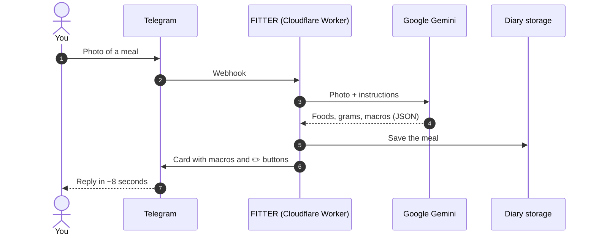

[English](README.md) · **العربية** · [简体中文](README.zh-CN.md) · [繁體中文](README.zh-TW.md) · [Čeština](README.cs.md) · [Français](README.fr.md) · [Deutsch](README.de.md) · [Ελληνικά](README.el.md) · [Bahasa Indonesia](README.id.md) · [Gaeilge](README.ga.md) · [Italiano](README.it.md) · [日本語](README.ja.md) · [한국어](README.ko.md) · [Polski](README.pl.md) · [Română](README.ro.md) · [Русский](README.ru.md) · [Español](README.es.md) · [Українська](README.uk.md) · [اردو](README.ur.md) · [ئۇيغۇرچە](README.ug.md) · [Tiếng Việt](README.vi.md) · [Português](README.pt.md) · [Türkçe](README.tr.md)

 

&nbsp;&nbsp;&nbsp;&nbsp;

<a href="#-features">سمات</a> · <a href="#-how-it-works">كيف يعمل</a> · <a href="#-screenshots">لقطات الشاشة</a> · <a href="https://t.me/arkhitkovv">اتصال</a>

> [!IMPORTANT]
> **FITTER تقدر السعرات الحرارية تقريبًا.** تعتمد نتائج الصور على المكونات وحجم الحصة، ويمكن تصحيح أي إدخال يدويًا. لا يحل الروبوت محل نصيحة الطبيب أو اختصاصي التغذية.

---

## 📸 لقطات الشاشة

  

---

## ✨ سمات

---

## 🤖 الأوامر

| يأمر | ماذا يفعل |
|:---|:---|
| `/start` | مقدمة واستطلاع |
| `/today` · `/week` | ملخص اليوم وآخر 7 أيام |
| `/water` · `/remind` | ماء اليوم وأذكاره |
| `/advice` | ماذا نأكل: 3 اقتراحات AI |
| `/pills` | الحبوب: علامة، إضافة، حذف |
| `/weight 72.5` | سجل وزنك |
| `/profile` | الملف الشخصي والهدف اليومي |
| `/awards` · `/analysis` | الإنجازات والمراجعة الأسبوعية لـ AI |
| `/app` | افتح اليوميات |
| `/reset` · `/help` | أعد إجراء الاستطلاع وساعد |
| `/devices` | عرض وفصل أجهزة Android التي تم تسجيل الدخول إليها |
| `/delete` | احذف جميع بياناتك |

---

## 🧠 كيف يعمل

| طبقة | تكنولوجيا | لماذا |
|:---|:---|:---|
| واجهة | Telegram بوت API + تطبيق صغير | كل شخص لديه Telegram بالفعل، ولا يوجد شيء يمكن تنزيله |
| الخادم | عمال كلاودفلير | مجاني، 24/7، لا توجد خوادم لإدارتها |
| AI | جوجل جيميني (فلاش / فلاش لايت) | يفهم الصور، ويرد بلغة JSON الصارمة |
| قاعدة البيانات | كائنات Cloudflare المتينة وKV | مذكرات متسقة يكتب والبيانات المخزنة مؤقتا |
| نشر | GitHub → إنشاءات Cloudflare | يتم شحن كل التزام إلى الخادم من تلقاء نفسه |

الخادم بأكمله عبارة عن ملف واحد, [`worker.js`](worker.js), مع التبعيات صفر.

---

## 🔒 الأمن والخصوصية

- يقبل خطاف الويب الطلبات ذات الرأس السري لـ Telegram فقط.
- تتحقق اليوميات من التوقيع المشفر لـ Telegram، لذلك لا يمكن لأحد فتح بيانات شخص آخر.
- المفاتيح تعيش في أسرار Cloudflare، وليس في الكود.
- الصور هي **غير مخزنة**: يذهبون إلى الجوزاء فقط من أجل الاعتراف بهم.

أكثر: [سياسة الخصوصية](https://sailxx.github.io/FITTER-AI/privacy.html).

---

## 🗺 خريطة الطريق

- [x] **الإصدار 1** روبوت Cloudflare، المسح، الهدف، تسجيل الصور، اليوميات، الوزن، الماء، الملصقات والرموز الشريطية
- [x] **الإصدار 2** “"ماذا نأكل" مساعد، حبوب مع تذكيرات، تحليلات، موضوع فاتح ومظلم
- [x] **v2.6** مظهر جديد للمذكرات، وتلميحات كلية، ومخطط أسبوعي؛ إعادة تصميم الماء والحبوب في الروبوت
- [x] **v3.0** المنتج: تطبيق Android مستقل مع عناصر واجهة المستخدم
- [x] **v3.8** الإنجليزية والروسية في كل مكان: الروبوت والمذكرات وتطبيق Android والأدوات والموقع الإلكتروني، مع تبديل اللغة
- [x] **v3.12** رموز تسجيل الدخول Android لمرة واحدة، وإلغاء الجهاز، ومزامنة أسرع للمذكرات

التاريخ الكامل: [CHANGELOG.md](CHANGELOG.md) ([باللغة الروسية](CHANGELOG.ru.md)).

---

## ❓ أسئلة وأفكار

وجدت خطأ أو لديك فكرة الميزة؟ افتح [مشكلة](https://github.com/sailxx/FITTER-AI/issues/new) أو أرسل رسالة للمؤلف على Telegram: [@arkhitkovv](https://t.me/arkhitkovv).

---

## ⚖️ رخصة

تم إصدار FITTER تحت **Apache 2.0** الترخيص، انظر [LICENSE](LICENSE). إنه مشروع مستقل ولا ينتمي إلى Telegram أو Google أو Cloudflare. جميع الأسماء تنتمي إلى أصحابها.

   
  
   
  <b>FITTER</b> · صورة واحدة. السيطرة الكاملة.
   

