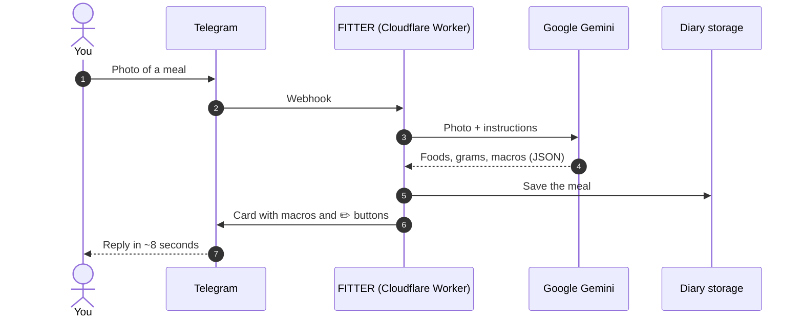

[English](README.md) · [العربية](README.ar.md) · [简体中文](README.zh-CN.md) · [繁體中文](README.zh-TW.md) · **Čeština** · [Français](README.fr.md) · [Deutsch](README.de.md) · [Ελληνικά](README.el.md) · [Bahasa Indonesia](README.id.md) · [Gaeilge](README.ga.md) · [Italiano](README.it.md) · [日本語](README.ja.md) · [한국어](README.ko.md) · [Polski](README.pl.md) · [Română](README.ro.md) · [Русский](README.ru.md) · [Español](README.es.md) · [Українська](README.uk.md) · [اردو](README.ur.md) · [ئۇيغۇرچە](README.ug.md) · [Tiếng Việt](README.vi.md) · [Português](README.pt.md) · [Türkçe](README.tr.md)

 

&nbsp; &nbsp;&nbsp; &nbsp;

<a href="#-features">Vlastnosti</a> · <a href="#-how-it-works">Jak to funguje</a> · <a href="#-screenshots">Snímky obrazovky</a> · <a href="https://t.me/arkhitkovv">Kontakt</a>

> [!IMPORTANT]
> **FITTER odhaduje kalorie přibližně.** Výsledky fotografií závisí na ingrediencích a velikosti porce a jakýkoli záznam lze opravit ručně. Robot nenahrazuje rady od lékaře nebo dietologa.

---

## 📸 Snímky obrazovky

  

---

## ✨ Vlastnosti

---

## 🤖 Příkazy

| Příkaz | Co to dělá |
|:---|:---|
| `/start` | Úvod a průzkum |
| `/today` · `/week` | Dnešní shrnutí a posledních 7 dní |
| `/water` · `/remind` | Dnešní voda a připomínky |
| `/advice` | Co jíst: 3 návrhy AI |
| `/pills` | Pilulky: označit, přidat, smazat |
| `/weight 72.5` | Zapište svou váhu |
| `/profile` | Profil a denní cíl |
| `/awards` · `/analysis` | Úspěchy a týdenní přehled AI |
| `/app` | Otevřete deník |
| `/reset` · `/help` | Zopakujte průzkum a pomozte |
| `/devices` | Zobrazení a odpojení přihlášených zařízení Android |
| `/delete` | Smažte všechna svá data |

---

## 🧠 Jak to funguje

| Vrstva | Technologie | Proč |
|:---|:---|:---|
| Rozhraní | Bot Telegram API + mini aplikace | Každý už má Telegram, není co stahovat |
| Server | Pracovníci Cloudflare | Zdarma, 24/7, žádné servery ke správě |
| AI | Google Gemini (Flash / Flash-Lite) | Rozumí fotkám, odpovídá striktně JSON |
| Databáze | Odolné objekty Cloudflare a KV | Konzistentní zápisy do deníku a data uložená v mezipaměti |
| Nasadit | GitHub → Cloudflare Builds | Každý commit se odesílá na server sám |

Celý server je jeden soubor, [`worker.js`](worker.js), s nulovými závislostmi.

---

## 🔒 Bezpečnost a soukromí

- Webhook přijímá pouze požadavky s tajnou hlavičkou Telegram.
- Deník kontroluje kryptografický podpis Telegram, takže nikdo nemůže otevřít data někoho jiného.
- Klíče žijí v tajemstvích Cloudflare, nikoli v kódu.
- Fotky jsou **neuloženo**: jdou k Blížencům jen pro uznání.

Více: [zásady ochrany osobních údajů](https://sailxx.github.io/FITTER-AI/privacy.html).

---

## 🗺 Cestovní mapa

- [x] **v1** Cloudflare bot, průzkum, cíl, protokolování fotografií, deník, váha, voda, štítky a čárové kódy
- [x] **v2** “Co jíst“ asistent, pilulky s připomenutím, analýzy, světlé a tmavé téma
- [x] **v2.6** Nový vzhled diáře, makro rady, týdenní graf; přepracovaná voda a pilulky v botě
- [x] **v3.0** Produkt: samostatná aplikace Android s widgety
- [x] **v3.8** Angličtina a ruština všude: robot, deník, aplikace Android, widgety a webové stránky s přepínačem jazyka
- [x] **v3.12** Jednorázové přihlašovací kódy Android, odvolání zařízení a rychlejší synchronizace deníku

Úplná historie: [CHANGELOG.md](CHANGELOG.md) ([v ruštině](CHANGELOG.ru.md)).

---

## ❓ Otázky a nápady

Našli jste chybu nebo máte nápad na funkci? Otevřete an [problém](https://github.com/sailxx/FITTER-AI/issues/new) nebo napište autorovi zprávu na Telegram: [@arkhitkovv](https://t.me/arkhitkovv).

---

## ⚖️ Licence

FITTER vychází pod **Apache 2.0** licence, viz [LICENSE](LICENSE). Je to nezávislý projekt a není spojen se Telegram, Google nebo Cloudflare. Všechna jména patří jejich majitelům.

   
  
   
  <b>FITTER</b> · Jedna fotka. Plná kontrola.
   

