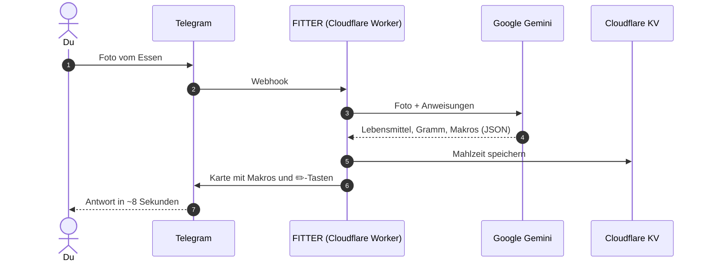

[Русский](README.ru.md) · [English](README.md) · [Español](README.es.md) · [Português](README.pt.md) · **Deutsch** · [Français](README.fr.md) · [Italiano](README.it.md) · [Türkçe](README.tr.md) · [Українська](README.uk.md) · [Polski](README.pl.md)

 

&nbsp;&nbsp;&nbsp;&nbsp;

<a href="#-funktionen">Funktionen</a> · <a href="#-so-funktionierts">So funktioniert’s</a> · <a href="#-screenshots">Screenshots</a> · <a href="https://t.me/arkhitkovv">Kontakt</a>

> [!IMPORTANT]
> **FITTER schätzt Kalorien nur ungefähr.** Das Ergebnis eines Fotos hängt von den Zutaten und der Portionsgröße ab, und jeder Eintrag lässt sich von Hand korrigieren. Der Bot ersetzt keine ärztliche oder ernährungsberaterische Beratung.

> [!NOTE]
> Der Bot spricht derzeit Russisch. Diese Seite ist eine Übersetzung der [russischen README](README.md).

---

## 📸 Screenshots

  

---

## ✨ Funktionen

---

## 🤖 Befehle

| Befehl | Was er tut |
|:---|:---|
| `/start` | Begrüßung und Fragebogen |
| `/today` · `/week` | Heute und die letzten 7 Tage |
| `/water` · `/remind` | Wasser heute und Erinnerungen |
| `/advice` | Was essen: 3 KI-Vorschläge |
| `/pills` | Tabletten: abhaken, hinzufügen, löschen |
| `/weight 72.5` | Gewicht eintragen |
| `/profile` | Profil und Tagesziel |
| `/awards` · `/analysis` | Erfolge und KI-Wochenrückblick |
| `/app` | Tagebuch öffnen |
| `/reset` · `/help` | Fragebogen neu ausfüllen und Hilfe |
| `/delete` | Alle deine Daten löschen |

---

## 🧠 So funktioniert’s

| Schicht | Technologie | Warum |
|:---|:---|:---|
| Oberfläche | Telegram Bot API + Mini App | Alle haben schon Telegram, nichts herunterzuladen |
| Server | Cloudflare Workers | Kostenlos, rund um die Uhr, keine Server zu pflegen |
| KI | Google Gemini (Flash / Flash-Lite) | Versteht Fotos, antwortet in strengem JSON |
| Datenbank | Cloudflare KV | Kostenlos und in Workers integriert |
| Deployment | GitHub → Cloudflare Builds | Jeder Commit landet von selbst auf dem Server |

Der gesamte Server ist eine einzige Datei, [`worker.js`](worker.js), ohne Abhängigkeiten.

---

## 🔒 Sicherheit und Datenschutz

- Der Webhook akzeptiert nur Anfragen mit dem geheimen Telegram-Header.
- Das Tagebuch prüft die kryptografische Signatur von Telegram: Fremde Daten lassen sich nicht öffnen.
- Schlüssel liegen in den Cloudflare-Secrets, nicht im Code.
- Fotos werden **nicht gespeichert**: Sie gehen nur zur Erkennung an Gemini.

Mehr dazu: [Datenschutzerklärung](https://sailxx.github.io/FITTER-AI/privacy.html) (auf Russisch).

---

## 🗺 Roadmap

- [x] **v1** Bot auf Cloudflare, Fragebogen, Tagesziel, Foto-Erfassung, Tagebuch, Gewicht, Wasser, Etiketten und Barcodes
- [x] **v2** Assistent „Was essen“, Tabletten mit Erinnerungen, Statistiken, helles und dunkles Design
- [x] **v2.6** Neues Tagebuch-Design, Makro-Tipps, Wochendiagramm; Wasser und Tabletten im Bot überarbeitet
- [ ] **v3.0** Produkt: eigenständige App

Vollständiger Verlauf: [CHANGELOG.md](CHANGELOG.md) (auf Russisch).

---

## ❓ Fragen und Ideen

Einen Fehler gefunden oder eine Idee? Öffne ein [Issue](https://github.com/sailxx/FITTER-AI/issues/new) oder schreib dem Autor auf Telegram: [@arkhitkovv](https://t.me/arkhitkovv).

---

## ⚖️ Lizenz

FITTER steht unter der **MIT**-Lizenz, siehe [LICENSE](LICENSE). Das Projekt ist unabhängig und steht in keiner Verbindung zu Telegram, Google oder Cloudflare. Die Namen gehören ihren Inhabern.

   
  
   
  <b>FITTER</b> · Ein Foto. Volle Kontrolle.
   
  Gemacht von <a href="https://t.me/arkhitkovv">Vlad</a>. Wenn dir das Projekt geholfen hat, gib dem Repo einen ⭐

