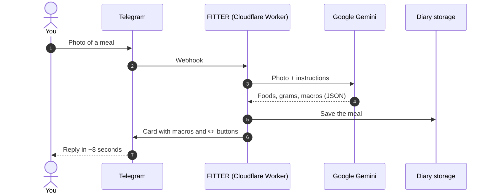

[English](README.md) · [العربية](README.ar.md) · [简体中文](README.zh-CN.md) · [繁體中文](README.zh-TW.md) · [Čeština](README.cs.md) · [Français](README.fr.md) · [Deutsch](README.de.md) · **Ελληνικά** · [Bahasa Indonesia](README.id.md) · [Gaeilge](README.ga.md) · [Italiano](README.it.md) · [日本語](README.ja.md) · [한국어](README.ko.md) · [Polski](README.pl.md) · [Română](README.ro.md) · [Русский](README.ru.md) · [Español](README.es.md) · [Українська](README.uk.md) · [اردو](README.ur.md) · [ئۇيغۇرچە](README.ug.md) · [Tiếng Việt](README.vi.md) · [Português](README.pt.md) · [Türkçe](README.tr.md)

 

&nbsp; &nbsp;&nbsp; &nbsp;

<a href="#-features">Χαρακτηριστικά</a> · <a href="#-how-it-works">Πώς λειτουργεί</a> · <a href="#-screenshots">Στιγμιότυπα οθόνης</a> · <a href="https://t.me/arkhitkovv">Επαφή</a>

> [!IMPORTANT]
> **Το FITTER υπολογίζει τις θερμίδες κατά προσέγγιση.** Τα αποτελέσματα των φωτογραφιών εξαρτώνται από τα συστατικά και το μέγεθος της μερίδας και οποιαδήποτε καταχώριση μπορεί να διορθωθεί με το χέρι. Το bot δεν αντικαθιστά τις συμβουλές γιατρού ή διαιτολόγου.

---

## 📸 Στιγμιότυπα οθόνης

  

---

## ✨ Χαρακτηριστικά

---

## 🤖 Εντολές

| Εντολή | Τι κάνει |
|:---|:---|
| `/start` | Εισαγωγή και έρευνα |
| `/today` · `/week` | Η σημερινή σύνοψη και οι τελευταίες 7 ημέρες |
| `/water` · `/remind` | Το σημερινό νερό και υπενθυμίσεις |
| `/advice` | Τι να φάτε: 3 προτάσεις AI |
| `/pills` | Χάπια: επισήμανση, προσθήκη, διαγραφή |
| `/weight 72.5` | Καταγράψτε το βάρος σας |
| `/profile` | Προφίλ και ημερήσιος στόχος |
| `/awards` · `/analysis` | Επιτεύγματα και εβδομαδιαία ανασκόπηση AI |
| `/app` | Ανοίξτε το ημερολόγιο |
| `/reset` · `/help` | Κάντε ξανά την έρευνα και βοηθήστε |
| `/devices` | Δείτε και αποσυνδέστε τις συνδεδεμένες συσκευές Android |
| `/delete` | Διαγράψτε όλα τα δεδομένα σας |

---

## 🧠 Πώς λειτουργεί

| Στρώμα | Τεχνολογία | Γιατί |
|:---|:---|:---|
| Διασύνδεση | Telegram Bot API + Μίνι εφαρμογή | Όλοι έχουν ήδη το Telegram, τίποτα για λήψη |
| Υπηρέτης | Cloudflare Workers | Δωρεάν, 24/7, χωρίς διακομιστές για διαχείριση |
| AI | Google Gemini (Flash / Flash-Lite) | Κατανοεί φωτογραφίες, απαντά αυστηρά JSON |
| Βάση δεδομένων | Cloudflare Durable Objects και KV | Συνεπής εγγραφή ημερολογίου και αποθήκευση δεδομένων στην κρυφή μνήμη |
| Αναπτύσσω | GitHub → Κατασκευές Cloudflare | Κάθε δέσμευση αποστέλλεται στον διακομιστή από μόνη της |

Ολόκληρος ο διακομιστής είναι ένα μόνο αρχείο, [`worker.js`](worker.js), με μηδενικές εξαρτήσεις.

---

## 🔒 Ασφάλεια και ιδιωτικότητα

- Το webhook δέχεται μόνο αιτήματα με τη μυστική κεφαλίδα του Telegram.
- Το ημερολόγιο ελέγχει την κρυπτογραφική υπογραφή του Telegram, ώστε κανείς να μην μπορεί να ανοίξει τα δεδομένα κάποιου άλλου.
- Τα κλειδιά ζουν στα μυστικά του Cloudflare, όχι στον κώδικα.
- Οι φωτογραφίες είναι **δεν αποθηκεύεται**: πάνε στους Διδύμους μόνο για αναγνώριση.

Περισσότερο: [πολιτική απορρήτου](https://sailxx.github.io/FITTER-AI/privacy.html).

---

## 🗺 Οδικός Χάρτης

- [x] **v1** Cloudflare bot, έρευνα, στόχος, καταγραφή φωτογραφιών, ημερολόγιο, βάρος, νερό, ετικέτες και γραμμωτοί κώδικες
- [x] **v2** “What to eat” βοηθός, χάπια με υπενθυμίσεις, αναλυτικά στοιχεία, ανοιχτό και σκοτεινό θέμα
- [x] **v2.6** Νέα εμφάνιση ημερολογίου, μακροεντολές, διάγραμμα εβδομάδας. επανασχεδιασμένο νερό και χάπια στο bot
- [x] **v3.0** Προϊόν: μια αυτόνομη εφαρμογή Android με γραφικά στοιχεία
- [x] **v3.8** Αγγλικά και ρωσικά παντού: bot, ημερολόγιο, εφαρμογή Android, γραφικά στοιχεία και ιστότοπος, με διακόπτη γλώσσας
- [x] **v3.12** Εφάπαξ κωδικοί σύνδεσης Android, ανάκληση συσκευής και ταχύτερος συγχρονισμός ημερολογίου

Πλήρες ιστορικό: [CHANGELOG.md](CHANGELOG.md) ([στα ρωσικά](CHANGELOG.ru.md)).

---

## ❓ Ερωτήσεις και ιδέες

Βρήκατε ένα σφάλμα ή έχετε μια ιδέα για το χαρακτηριστικό; Ανοίξτε ένα [ζήτημα](https://github.com/sailxx/FITTER-AI/issues/new) ή στείλτε μήνυμα στον συγγραφέα στο Telegram: [@arkhitkovv](https://t.me/arkhitkovv).

---

## ⚖️ Αδεια

Το FITTER κυκλοφορεί κάτω από το **Apache 2.0** άδεια, βλ [LICENSE](LICENSE). Είναι ένα ανεξάρτητο έργο και δεν συνδέεται με το Telegram, το Google ή το Cloudflare. Όλα τα ονόματα ανήκουν στους ιδιοκτήτες τους.

   
  
   
  <b>FITTER</b> · Μία φωτογραφία. Πλήρης έλεγχος.
   

