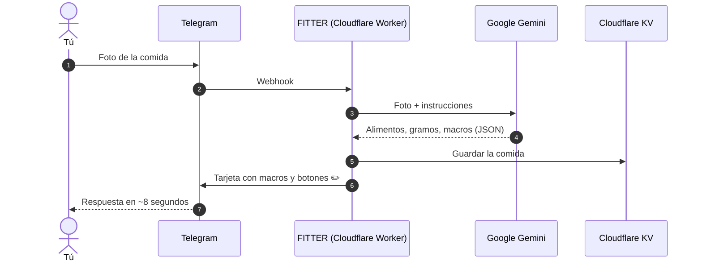

[Русский](README.md) · [English](README.en.md) · **Español** · [Português](README.pt.md) · [Deutsch](README.de.md) · [Français](README.fr.md) · [Italiano](README.it.md) · [Türkçe](README.tr.md) · [Українська](README.uk.md) · [Polski](README.pl.md)

 

&nbsp;&nbsp;

<a href="#-funciones">Funciones</a> · <a href="#-cómo-funciona">Cómo funciona</a> · <a href="#-capturas">Capturas</a> · <a href="https://t.me/arkhitkovv">Contacto</a>

> [!IMPORTANT]
> **FITTER calcula las calorías de forma aproximada.** El resultado de una foto depende de los ingredientes y del tamaño de la ración, y cualquier registro se puede corregir a mano. El bot no sustituye la consulta con un médico o nutricionista.

> [!NOTE]
> Por ahora el bot habla ruso. Esta página es una traducción del [README en ruso](README.md).

---

## 📸 Capturas

  

---

## ✨ Funciones

---

## 🤖 Comandos

| Comando | Qué hace |
|:---|:---|
| `/start` | Presentación y encuesta |
| `/today` · `/week` | Resumen de hoy y de los últimos 7 días |
| `/water` · `/remind` | Agua de hoy y recordatorios |
| `/advice` | Qué comer: 3 sugerencias de la IA |
| `/pills` | Pastillas: marcar, añadir, borrar |
| `/weight 72.5` | Registrar el peso |
| `/profile` | Perfil y objetivo diario |
| `/awards` · `/analysis` | Logros y resumen semanal con IA |
| `/app` | Abrir el diario |
| `/reset` · `/help` | Repetir la encuesta y ayuda |
| `/delete` | Borrar todos tus datos |

---

## 🧠 Cómo funciona

| Capa | Tecnología | Por qué |
|:---|:---|:---|
| Interfaz | Telegram Bot API + Mini App | Todo el mundo tiene Telegram, no hay nada que descargar |
| Servidor | Cloudflare Workers | Gratis, 24/7, sin servidores que mantener |
| IA | Google Gemini (Flash / Flash-Lite) | Entiende fotos y responde en JSON estricto |
| Base de datos | Cloudflare KV | Gratis e integrada en Workers |
| Despliegue | GitHub → Cloudflare Builds | Cada commit llega solo al servidor |

Todo el servidor es un único archivo, [`worker.js`](worker.js), sin dependencias.

---

## 🔒 Seguridad y privacidad

- El webhook solo acepta solicitudes con la cabecera secreta de Telegram.
- El diario comprueba la firma criptográfica de Telegram: nadie puede abrir datos ajenos.
- Las claves están en los secretos de Cloudflare, no en el código.
- Las fotos **no se guardan**: solo se envían a Gemini para el reconocimiento.

Más información: [política de privacidad](https://sailxx.github.io/FITTER-AI/privacy.html) (en ruso).

---

## 🗺 Hoja de ruta

- [x] **v1** Bot en Cloudflare, encuesta, objetivo, registro por foto, diario, peso, agua, etiquetas y códigos de barras
- [x] **v2** Asistente «Qué comer», pastillas con recordatorios, estadísticas, tema claro y oscuro
- [x] **v2.6** Nuevo diseño del diario, consejos de macros, gráfico semanal; agua y pastillas renovadas en el bot
- [ ] **v3.0** Producto: app independiente

Historial completo: [CHANGELOG.md](CHANGELOG.md) (en ruso).

---

## ❓ Preguntas e ideas

¿Encontraste un error o tienes una idea? Abre un [issue](https://github.com/sailxx/FITTER-AI/issues/new) o escribe al autor en Telegram: [@arkhitkovv](https://t.me/arkhitkovv).

---

## ⚖️ Licencia

FITTER se distribuye bajo la licencia **MIT**, consulta [LICENSE](LICENSE). Es un proyecto independiente y no está vinculado a Telegram, Google ni Cloudflare. Los nombres pertenecen a sus propietarios.

   
  
   
  <b>FITTER</b> · Una foto. Control total.
   
  Hecho por <a href="https://t.me/arkhitkovv">Vlad</a>. Si el proyecto te sirvió, dale una ⭐ al repositorio.

