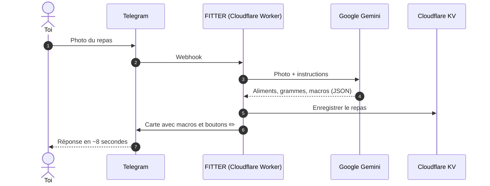

[Русский](README.ru.md) · [English](README.md) · [Español](README.es.md) · [Português](README.pt.md) · [Deutsch](README.de.md) · **Français** · [Italiano](README.it.md) · [Türkçe](README.tr.md) · [Українська](README.uk.md) · [Polski](README.pl.md)

 

&nbsp;&nbsp;&nbsp;&nbsp;

<a href="#-fonctionnalités">Fonctionnalités</a> · <a href="#-comment-ça-marche">Comment ça marche</a> · <a href="#-captures-décran">Captures</a> · <a href="https://t.me/arkhitkovv">Contact</a>

> [!IMPORTANT]
> **FITTER estime les calories de façon approximative.** Le résultat d’une photo dépend des ingrédients et de la taille de la portion, et chaque entrée peut être corrigée à la main. Le bot ne remplace pas l’avis d’un médecin ou d’un diététicien.

> [!NOTE]
> Pour l’instant, le bot parle russe. Cette page est une traduction du [README en russe](README.md).

---

## 📸 Captures d’écran

  

---

## ✨ Fonctionnalités

---

## 🤖 Commandes

| Commande | Ce qu’elle fait |
|:---|:---|
| `/start` | Présentation et questionnaire |
| `/today` · `/week` | Bilan du jour et des 7 derniers jours |
| `/water` · `/remind` | Eau du jour et rappels |
| `/advice` | Quoi manger : 3 idées de l’IA |
| `/pills` | Médicaments : cocher, ajouter, supprimer |
| `/weight 72.5` | Noter son poids |
| `/profile` | Profil et objectif quotidien |
| `/awards` · `/analysis` | Succès et bilan IA de la semaine |
| `/app` | Ouvrir le journal |
| `/reset` · `/help` | Refaire le questionnaire et aide |
| `/delete` | Supprimer toutes tes données |

---

## 🧠 Comment ça marche

| Couche | Technologie | Pourquoi |
|:---|:---|:---|
| Interface | Telegram Bot API + Mini App | Tout le monde a déjà Telegram, rien à télécharger |
| Serveur | Cloudflare Workers | Gratuit, 24 h/24, aucun serveur à gérer |
| IA | Google Gemini (Flash / Flash-Lite) | Comprend les photos, répond en JSON strict |
| Base de données | Cloudflare KV | Gratuite et intégrée à Workers |
| Déploiement | GitHub → Cloudflare Builds | Chaque commit arrive tout seul sur le serveur |

Tout le serveur tient dans un seul fichier, [`worker.js`](worker.js), sans aucune dépendance.

---

## 🔒 Sécurité et confidentialité

- Le webhook n’accepte que les requêtes avec l’en-tête secret de Telegram.
- Le journal vérifie la signature cryptographique de Telegram : impossible d’ouvrir les données d’un autre.
- Les clés sont dans les secrets Cloudflare, pas dans le code.
- Les photos **ne sont pas conservées** : elles partent vers Gemini uniquement pour la reconnaissance.

En savoir plus : [politique de confidentialité](https://sailxx.github.io/FITTER-AI/privacy.html).

---

## 🗺 Feuille de route

- [x] **v1** Bot sur Cloudflare, questionnaire, objectif, saisie par photo, journal, poids, eau, étiquettes et codes-barres
- [x] **v2** Assistant « Quoi manger », médicaments avec rappels, statistiques, thème clair et sombre
- [x] **v2.6** Nouveau design du journal, conseils de macros, graphique de la semaine ; eau et médicaments repensés dans le bot
- [ ] **v3.0** Produit : application autonome

Historique complet : [CHANGELOG.md](CHANGELOG.md).

---

## ❓ Questions et idées

Tu as trouvé un bug ou tu as une idée ? Ouvre une [issue](https://github.com/sailxx/FITTER-AI/issues/new) ou écris à l’auteur sur Telegram : [@arkhitkovv](https://t.me/arkhitkovv).

---

## ⚖️ Licence

FITTER est distribué sous licence **MIT**, voir [LICENSE](LICENSE). C’est un projet indépendant, sans lien avec Telegram, Google ou Cloudflare. Les noms appartiennent à leurs propriétaires.

   
  
   
  <b>FITTER</b> · Une photo. Le contrôle total.
   
  Fait par <a href="https://t.me/arkhitkovv">Vlad</a>. Si le projet t’a servi, laisse une ⭐ au dépôt.

