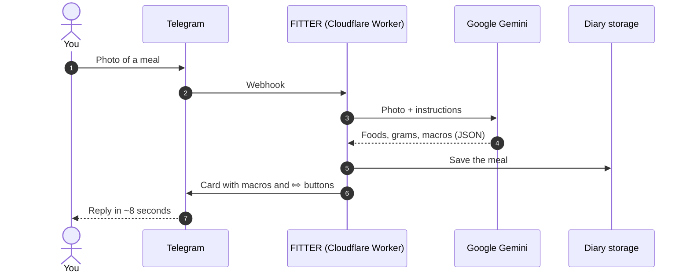

[English](README.md) · [العربية](README.ar.md) · [简体中文](README.zh-CN.md) · [繁體中文](README.zh-TW.md) · [Čeština](README.cs.md) · [Français](README.fr.md) · [Deutsch](README.de.md) · [Ελληνικά](README.el.md) · [Bahasa Indonesia](README.id.md) · **Gaeilge** · [Italiano](README.it.md) · [日本語](README.ja.md) · [한국어](README.ko.md) · [Polski](README.pl.md) · [Română](README.ro.md) · [Русский](README.ru.md) · [Español](README.es.md) · [Українська](README.uk.md) · [اردو](README.ur.md) · [ئۇيغۇرچە](README.ug.md) · [Tiếng Việt](README.vi.md) · [Português](README.pt.md) · [Türkçe](README.tr.md)

 

&nbsp; &nbsp;&nbsp; &nbsp;

<a href="#-features">Gnéithe</a> · <a href="#-how-it-works">Conas a oibríonn sé</a> · <a href="#-screenshots">Seatanna scáileáin</a> · <a href="https://t.me/arkhitkovv">Teagmháil</a>

> [!IMPORTANT]
> **Measann FITTER thart ar chalaraí.** Braitheann torthaí grianghraf ar na comhábhair agus ar mhéid na coda, agus is féidir aon iontráil a cheartú de láimh. Ní thagann an bot in ionad comhairle ó dhochtúir nó ó bhia-eolaí.

---

## 📸 Seatanna scáileáin

  

---

## ✨ Gnéithe

---

## 🤖 Orduithe

| Ordú | Cad a dhéanann sé |
|:---|:---|
| `/start` | Réamhrá agus suirbhé |
| `/today` · `/week` | Achoimre an lae inniu agus na 7 lá deiridh |
| `/water` · `/remind` | Uisce agus meabhrúcháin an lae inniu |
| `/advice` | Cad a ithe: 3 moltaí AI |
| `/pills` | Pills: marcáil, cuir leis, scrios |
| `/weight 72.5` | Log do mheáchan |
| `/profile` | Próifíl agus sprioc laethúil |
| `/awards` · `/analysis` | Éachtaí agus AI athbhreithniú seachtainiúil |
| `/app` | Oscail an dialann |
| `/reset` · `/help` | Déan an suirbhé arís agus cuidigh leat |
| `/devices` | Féach ar agus dínasc gléasanna Android sínithe isteach |
| `/delete` | Scrios do shonraí go léir |

---

## 🧠 Conas a oibríonn sé

| Ciseal | Teicneolaíocht | Cén fáth |
|:---|:---|:---|
| Comhéadan | Telegram Bot API + Mini App | Tá Telegram ag gach duine cheana féin, níl aon rud le híoslódáil |
| Freastalaí | Oibrithe Cloudflare | Saor in aisce, 24/7, gan freastalaithe le bainistiú |
| AI | Google Gemini (Flash / Flash-Lite) | Tuigeann sé grianghraif, freagraíonn sé go docht JSON |
| Bunachar Sonraí | Cuspóirí Durable Cloudflare agus KV | Scríobhann dialann comhsheasmhach agus sonraí i dtaisce |
| Imscaradh | GitHub → Tógann Cloudflare | Déanann gach tiomnú long chuig an bhfreastalaí leis féin |

Is comhad amháin é an freastalaí iomlán, [`worker.js`](worker.js), le nialas spleáchais.

---

## 🔒 Slándáil agus príobháideacht

- Ní ghlacann an gréasán ach le hiarratais a bhfuil ceanntásc rúnda Telegram orthu.
- Seiceálann an dialann síniú cripteagrafach Telegram, mar sin ní féidir le duine ar bith sonraí duine eile a oscailt.
- Cónaíonn eochracha i rúin Cloudflare, ní sa chód.
- Tá grianghraif **nach bhfuil stóráilte**: ní théann siad chuig Gemini ach le haghaidh aitheantais.

Tuilleadh: [polasaí príobháideachta](https://sailxx.github.io/FITTER-AI/privacy.html).

---

## 🗺 Treochlár

- [x] **v1** Cloudflare bot, suirbhé, sprioc, logáil grianghraf, dialann, meáchan, uisce, lipéid agus barrachóid
- [x] **v2** “Cad atá le hithe” cúntóir, piollaí le meabhrúcháin, anailísíocht, téama éadrom agus dorcha
- [x] **v2.6** Cuma dialainne nua, leideanna macra, cairt seachtaine; uisce athdheartha agus piollaí sa bot
- [x] **v3.0** Táirge: aip Android neamhspleách le giuirléidí
- [x] **v3.8** Béarla agus Rúisis i ngach áit: bot, dialann, aip Android, giuirléidí agus suíomh Gréasáin, le lasc teanga
- [x] **v3.12** Cóid aonuaire síniú isteach Android, cúlghairm gléas agus sioncrónú dialainne níos tapúla

Stair iomlán: [CHANGELOG.md](CHANGELOG.md) ([i Rúisis](CHANGELOG.ru.md)).

---

## ❓ Ceisteanna agus smaointe

Aimsíodh fabht nó an bhfuil smaoineamh gné agat? Oscail an [eisiúint](https://github.com/sailxx/FITTER-AI/issues/new) nó cuir teachtaireacht chuig an údar ar Telegram: [@arkhitkovv](https://t.me/arkhitkovv).

---

## ⚖️ Ceadúnas

Tá FITTER scaoileadh faoin **Apache 2.0** ceadúnas, féach [LICENSE](LICENSE). Is tionscadal neamhspleách é agus níl sé cleamhnaithe le Telegram , Google nó Cloudflare. Baineann gach ainm lena n-úinéirí.

   
  
   
  <b>FITTER</b> · Grianghraf amháin. Rialú iomlán.
   

