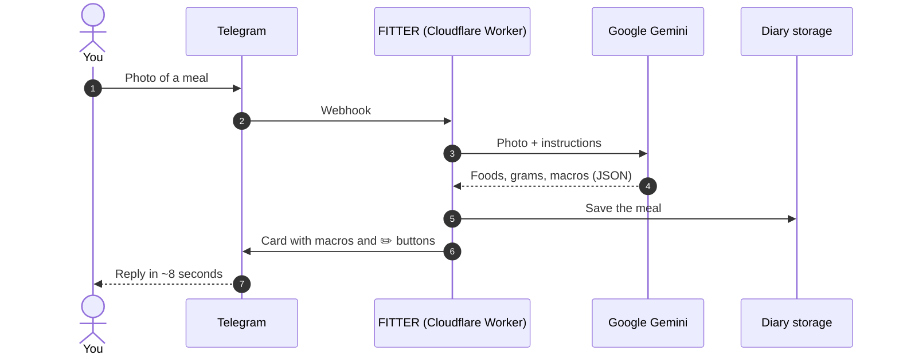

[English](README.md) · [العربية](README.ar.md) · [简体中文](README.zh-CN.md) · [繁體中文](README.zh-TW.md) · [Čeština](README.cs.md) · [Français](README.fr.md) · [Deutsch](README.de.md) · [Ελληνικά](README.el.md) · **Bahasa Indonesia** · [Gaeilge](README.ga.md) · [Italiano](README.it.md) · [日本語](README.ja.md) · [한국어](README.ko.md) · [Polski](README.pl.md) · [Română](README.ro.md) · [Русский](README.ru.md) · [Español](README.es.md) · [Українська](README.uk.md) · [اردو](README.ur.md) · [ئۇيغۇرچە](README.ug.md) · [Tiếng Việt](README.vi.md) · [Português](README.pt.md) · [Türkçe](README.tr.md)

 

&nbsp; & nbsp;&nbsp; & nbsp;

<a href="#-features">Fitur</a> · <a href="#-how-it-works">Bagaimana cara kerjanya</a> · <a href="#-screenshots">Tangkapan layar</a> · <a href="https://t.me/arkhitkovv">Kontak</a>

> [!IMPORTANT]
> **FITTER memperkirakan kira-kira kalori.** Hasil foto tergantung bahan dan ukuran porsi, dan entri apa pun bisa diperbaiki dengan tangan. Bot tidak menggantikan saran dari dokter atau ahli gizi.

---

## 📸 Tangkapan layar

  

---

## ✨ Fitur

---

## 🤖 Perintah

| Memerintah | Apa fungsinya |
|:---|:---|
| `/start` | Pendahuluan dan survei |
| `/today` · `/week` | Ringkasan hari ini dan 7 hari terakhir |
| `/water` · `/remind` | Air dan pengingat hari ini |
| `/advice` | Apa yang harus dimakan: 3 saran AI |
| `/pills` | Pil: tandai, tambah, hapus |
| `/weight 72.5` | Catat berat badan Anda |
| `/profile` | Profil dan target harian |
| `/awards` · `/analysis` | Prestasi dan ulasan mingguan AI |
| `/app` | Buka buku harian itu |
| `/reset` · `/help` | Ikuti kembali survei dan bantuan |
| `/devices` | Lihat dan putuskan sambungan perangkat Android yang masuk |
| `/delete` | Hapus semua data Anda |

---

## 🧠 Bagaimana cara kerjanya

| Lapisan | Teknologi | Mengapa |
|:---|:---|:---|
| Antarmuka | Telegram Bot API + Aplikasi Mini | Semua orang sudah memiliki Telegram, tidak ada yang perlu diunduh |
| pelayan | Pekerja Cloudflare | Gratis, 24/7, tidak ada server yang perlu dikelola |
| AI | Google Gemini (Flash / Flash-Lite) | Memahami foto, membalas dengan JSON yang ketat |
| Basis data | Objek Tahan Lama Cloudflare dan KV | Penulisan buku harian dan data cache yang konsisten |
| Menyebarkan | GitHub → Pembuatan Cloudflare | Setiap komit dikirimkan ke server dengan sendirinya |

Seluruh server adalah satu file, [`worker.js`](worker.js), dengan ketergantungan nol.

---

## 🔒 Keamanan dan privasi

- Webhook hanya menerima permintaan dengan header rahasia Telegram.
- Buku harian itu memeriksa tanda tangan kriptografi Telegram, sehingga tidak ada yang bisa membuka data orang lain.
- Kuncinya ada di rahasia Cloudflare, bukan di kodenya.
- Foto adalah **tidak disimpan**: mereka pergi ke Gemini hanya untuk mendapatkan pengakuan.

Lagi: [kebijakan privasi](https://sailxx.github.io/FITTER-AI/privacy.html).

---

## 🗺 Peta jalan

- [x] **v1** Bot Cloudflare, survei, target, pencatatan foto, buku harian, berat, air, label, dan kode batang
- [x] **v2** “Asisten apa yang harus dimakan”, pil dengan pengingat, analitik, tema terang dan gelap
- [x] **v2.6** Tampilan buku harian baru, petunjuk makro, grafik minggu; mendesain ulang air dan pil di bot
- [x] **v3.0** Produk: aplikasi Android mandiri dengan widget
- [x] **v3.8** Bahasa Inggris dan Rusia di mana saja: bot, buku harian, aplikasi Android, widget dan situs web, dengan peralihan bahasa
- [x] **v3.12** Kode masuk Android satu kali, pencabutan perangkat, dan sinkronisasi buku harian yang lebih cepat

Sejarah lengkap: [CHANGELOG.md](CHANGELOG.md) ([dalam bahasa Rusia](CHANGELOG.ru.md)).

---

## ❓ Pertanyaan dan ide

Menemukan bug atau punya ide fitur? Buka sebuah [masalah](https://github.com/sailxx/FITTER-AI/issues/new) atau kirim pesan ke penulis di Telegram: [@arkhitkovv](https://t.me/arkhitkovv).

---

## ⚖️ Lisensi

FITTER dirilis di bawah **Apache 2.0** lisensi, lihat [LICENSE](LICENSE). Ini adalah proyek independen dan tidak berafiliasi dengan Telegram, Google atau Cloudflare. Semua nama adalah milik pemiliknya.

   
  
   
  <b>FITTER</b> · Satu foto. Kontrol penuh.
   

