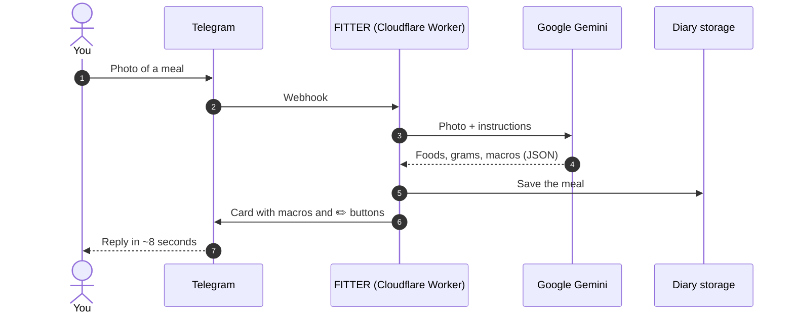

[English](README.md) · [العربية](README.ar.md) · [简体中文](README.zh-CN.md) · [繁體中文](README.zh-TW.md) · [Čeština](README.cs.md) · [Français](README.fr.md) · [Deutsch](README.de.md) · [Ελληνικά](README.el.md) · [Bahasa Indonesia](README.id.md) · [Gaeilge](README.ga.md) · [Italiano](README.it.md) · **日本語** · [한국어](README.ko.md) · [Polski](README.pl.md) · [Română](README.ro.md) · [Русский](README.ru.md) · [Español](README.es.md) · [Українська](README.uk.md) · [اردو](README.ur.md) · [ئۇيغۇرچە](README.ug.md) · [Tiếng Việt](README.vi.md) · [Português](README.pt.md) · [Türkçe](README.tr.md)

 

&nbsp;&nbsp;&nbsp;&nbsp;

<a href="#-features">特徴</a> · <a href="#-how-it-works">仕組み</a> · <a href="#-screenshots">スクリーンショット</a> · <a href="https://t.me/arkhitkovv">接触</a>

> [!IMPORTANT]
> **FITTERはおおよそのカロリーを見積もっています。** 写真の結果は材料と分量によって異なりますが、入力した内容は手動で修正できます。ボットは医師や栄養士からのアドバイスに代わるものではありません。

---

## 📸 スクリーンショット

  

---

## ✨ 特徴

---

## 🤖 コマンド

| 指示 | 何をするのか |
|:---|:---|
| `/start` | 紹介と調査 |
| `/today` · `/week` | 今日のまとめと過去7日間 |
| `/water` · `/remind` | 今日の水とリマインダー |
| `/advice` | 何を食べるか: AI の 3 つの提案 |
| `/pills` | 錠剤: マーク、追加、削除 |
| `/weight 72.5` | 体重を記録します |
| `/profile` | プロフィールと一日の目標 |
| `/awards` · `/analysis` | 実績とAIの週次レビュー |
| `/app` | 日記を開く |
| `/reset` · `/help` | 再度アンケートに答えて協力してください |
| `/devices` | サインインしている Android デバイスの表示と切断 |
| `/delete` | すべてのデータを削除します |

---

## 🧠 仕組み

| 層 | テクノロジー | なぜ |
|:---|:---|:---|
| インタフェース | Telegram ボット API + ミニアプリ | 誰もがすでに Telegram を持っているので、ダウンロードするものはありません |
| サーバ | Cloudflare ワーカー | 無料、年中無休、サーバー管理不要 |
| AI | Google Gemini (Flash / Flash-Lite) | 写真を理解し、厳密な JSON で返信します |
| データベース | Cloudflare デュラブル オブジェクトと KV | 一貫した日記の書き込みとキャッシュされたデータ |
| 展開する | GitHub → Cloudflare ビルド | すべてのコミットはそれ自体でサーバーに送信されます |

サーバー全体が 1 つのファイルである, [`worker.js`](worker.js), 依存関係はゼロです。

---

## 🔒 セキュリティとプライバシー

- Webhook は、 Telegram のシークレット ヘッダーを持つリクエストのみを受け入れます。
- 日記は Telegram の暗号署名をチェックするため、誰も他人のデータを開くことができません。
- キーはコード内ではなく、Cloudflare シークレット内に存在します。
- 写真は **保存されていない**: 彼らは認められるためだけにジェミニに行きます。

もっと: [プライバシーポリシー](https://sailxx.github.io/FITTER-AI/privacy.html).

---

## 🗺 ロードマップ

- [x] **v1** Cloudflare ボット、調査、ターゲット、写真記録、日記、体重、水、ラベル、バーコード
- [x] **v2** “「何を食べるか」アシスタント、リマインダー付きの錠剤、分析、明暗のテーマ
- [x] **v2.6** 新しい日記の外観、マクロのヒント、週グラフ。ボット内の水と錠剤の再設計
- [x] **v3.0** 製品: ウィジェットを備えたスタンドアロン Android アプリ
- [x] **v3.8** どこでも英語とロシア語: ボット、日記、Android アプリ、ウィジェット、ウェブサイト、言語スイッチ付き
- [x] **v3.12** ワンタイム Android サインイン コード、デバイスの取り消し、およびより高速な日記同期

全履歴: [CHANGELOG.md](CHANGELOG.md) ([ロシア語で](CHANGELOG.ru.md)).

---

## ❓ 質問とアイデア

バグを見つけましたか、それとも機能のアイデアがありますか?開く [問題](https://github.com/sailxx/FITTER-AI/issues/new) または、Telegram の作者にメッセージを送信してください: [@arkhitkovv](https://t.me/arkhitkovv).

---

## ⚖️ ライセンス

FITTERは **Apache 2.0** ライセンス、参照 [LICENSE](LICENSE)。これは独立したプロジェクトであり、Telegram、Google、Cloudflareとは提携していません。すべての名前はその所有者に属します。

   
  
   
  <b>FITTER</b> · 写真1枚。フルコントロール。
   

