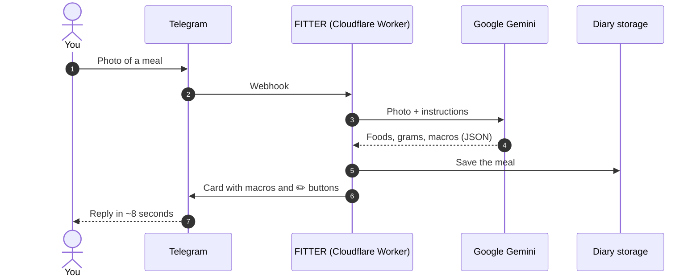

[English](README.md) · [العربية](README.ar.md) · [简体中文](README.zh-CN.md) · [繁體中文](README.zh-TW.md) · [Čeština](README.cs.md) · [Français](README.fr.md) · [Deutsch](README.de.md) · [Ελληνικά](README.el.md) · [Bahasa Indonesia](README.id.md) · [Gaeilge](README.ga.md) · [Italiano](README.it.md) · [日本語](README.ja.md) · **한국어** · [Polski](README.pl.md) · [Română](README.ro.md) · [Русский](README.ru.md) · [Español](README.es.md) · [Українська](README.uk.md) · [اردو](README.ur.md) · [ئۇيغۇرچە](README.ug.md) · [Tiếng Việt](README.vi.md) · [Português](README.pt.md) · [Türkçe](README.tr.md)

 

&nbsp; &nbsp;&nbsp; &nbsp;

<a href="#-features">특징</a> · <a href="#-how-it-works">작동 원리</a> · <a href="#-screenshots">스크린샷</a> · <a href="https://t.me/arkhitkovv">연락하다</a>

> [!IMPORTANT]
> **FITTER는 대략적인 칼로리를 추정합니다.** 사진 결과는 재료와 부분 크기에 따라 달라지며, 모든 항목은 직접 수정할 수 있습니다. 로봇은 의사나 영양사의 조언을 대체하지 않습니다.

---

## 📸 스크린샷

  

---

## ✨ 특징

---

## 🤖 명령

| 명령 | 기능 |
|:---|:---|
| `/start` | 소개 및 설문조사 |
| `/today` · `/week` | 오늘의 요약과 지난 7일 |
| `/water` · `/remind` | 오늘의 물과 알림 |
| `/advice` | 무엇을 먹을까: AI 제안 3가지 |
| `/pills` | 알약: 표시, 추가, 삭제 |
| `/weight 72.5` | 체중을 기록하세요 |
| `/profile` | 프로필 및 일일 목표 |
| `/awards` · `/analysis` | 성과 및 AI 주간 검토 |
| `/app` | 일기장을 열어보세요 |
| `/reset` · `/help` | 설문조사를 다시 작성하고 도움을 받으세요. |
| `/devices` | 로그인된 Android 장치 보기 및 연결 해제 |
| `/delete` | 모든 데이터 삭제 |

---

## 🧠 작동 원리

| 층 | 기술 | 왜 |
|:---|:---|:---|
| 인터페이스 | Telegram 봇 API + 미니 앱 | 모두가 이미 Telegram를 가지고 있으므로 다운로드할 것이 없습니다. |
| 섬기는 사람 | Cloudflare 작업자 | 무료, 연중무휴, 관리할 서버 없음 |
| AI | Google Gemini(플래시/Flash-Lite) | 사진을 이해하고 엄격한 JSON로 답변합니다. |
| 데이터 베이스 | Cloudflare 내구성 개체 및 KV | 일관된 일기 쓰기 및 캐시된 데이터 |
| 배포 | GitHub → Cloudflare 빌드 | 모든 커밋은 서버 자체로 전달됩니다. |

전체 서버는 단일 파일입니다, [`worker.js`](worker.js), 의존성이 전혀 없습니다.

---

## 🔒 보안 및 개인 정보 보호

- 웹훅은 Telegram의 비밀 헤더가 있는 요청만 허용합니다.
- 다이어리는 Telegram의 암호화 서명을 확인하므로 누구도 다른 사람의 데이터를 열 수 없습니다.
- 키는 코드가 아닌 Cloudflare 비밀에 있습니다.
- 사진은 **저장되지 않음**: 그들은 인정을 위해서만 쌍둥이 자리에갑니다.

더: [개인 정보 보호 정책](https://sailxx.github.io/FITTER-AI/privacy.html).

---

## 🗺 로드맵

- [x] **v1** Cloudflare 봇, 설문조사, 대상, 사진 로깅, 일기, 무게, 물, 라벨 및 바코드
- [x] **v2** “무엇을 먹을까” 보조자, 알림, 분석, 밝은 테마와 어두운 테마가 포함된 알약
- [x] **v2.6** 새로운 일기 모습, 매크로 힌트, 주간 차트; 봇의 물과 알약을 재설계했습니다.
- [x] **v3.0** 제품: 위젯이 포함된 독립형 Android 앱
- [x] **v3.8** 어디에서나 영어와 러시아어: 봇, 일기, Android 앱, 위젯 및 웹사이트(언어 전환 포함)
- [x] **v3.12** 일회성 Android 로그인 코드, 장치 취소 및 더 빠른 일기 동기화

전체 역사: [CHANGELOG.md](CHANGELOG.md) ([러시아어로](CHANGELOG.ru.md)).

---

## ❓ 질문과 아이디어

버그를 발견했거나 기능에 대한 아이디어가 있습니까? 열기 [문제](https://github.com/sailxx/FITTER-AI/issues/new) 또는 Telegram로 작성자에게 메시지를 보내세요.: [@arkhitkovv](https://t.me/arkhitkovv).

---

## ⚖️ 특허

FITTER는 다음과 같이 출시됩니다. **Apache 2.0** 라이센스, 참조 [LICENSE](LICENSE). 이는 독립적인 프로젝트이며 Telegram, Google 또는 Cloudflare와 관련이 없습니다. 모든 이름은 해당 소유자의 것입니다.

   
  
   
  <b>FITTER</b> · 사진 한 장. 모든 권한을 갖습니다.
   

