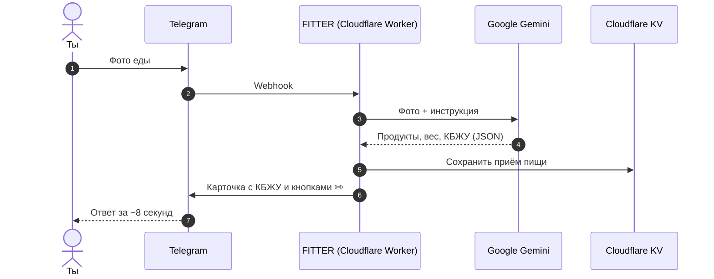

**Русский** · [English](README.en.md) · [Español](README.es.md) · [Português](README.pt.md) · [Deutsch](README.de.md) · [Français](README.fr.md) · [Italiano](README.it.md) · [Türkçe](README.tr.md) · [Українська](README.uk.md) · [Polski](README.pl.md)

 

&nbsp;&nbsp;&nbsp;&nbsp;

<a href="#-возможности">Возможности</a> · <a href="#-как-это-работает">Как работает</a> · <a href="#-скриншоты">Скриншоты</a> · <a href="https://t.me/arkhitkovv">Связь</a>

> [!IMPORTANT]
> **FITTER оценивает калории приблизительно.** Результат по фото зависит от состава и размера порции, а любую запись можно поправить вручную. Бот не заменяет консультацию врача или диетолога.

---

## 📱 Приложение для Android

 Android 8.0+ · около 3 МБ · бесплатно, без рекламы

### Установка

1. Скачай **[Fitter.apk](https://github.com/sailxx/FITTER-AI/releases/latest/download/Fitter.apk)** с телефона (или открой [страницу релизов](https://github.com/sailxx/FITTER-AI/releases/latest)).
2. Открой файл. Android спросит разрешение на установку из этого источника — разреши его для браузера или «Файлов». Это нужно один раз: приложения нет в Google Play.
3. Нажми «Установить» и открой Fitter.
4. Нажми **«Войти через Telegram»**: откроется бот @FitterFoodBot, подтверди вход кнопкой «✅ Да, это я» и вернись в приложение. Паролей нет.
5. Если ты ещё не пользовался ботом, он сначала задаст 6 вопросов анкеты — по ним считается твоя норма. Результат появится на экране «Сегодня».
6. Разреши уведомления, если нужны напоминания о воде, еде и таблетках. Виджеты добавляются с рабочего стола: долгое нажатие → «Виджеты» → Fitter.

Обновляется так же: скачай новый `Fitter.apk` и установи поверх, данные сохранятся — они хранятся в боте.

### Что внутри

- Экран «Сегодня»: кольцо калорий, БЖУ, вода стаканами, таблетки и еда за день
- 8 виджетов: «Калории», «Сегодня», «Вода» с кнопками, «БЖУ», «Неделя», «Таблетки», «Осталось» и «Фото еды» — белые или чёрные по теме Fitter, прозрачность и содержимое настраиваются
- Еда прямо в приложении: текстом, снимком с камеры или фото из галереи
- Живая синхронизация с ботом: записи появляются сразу в обе стороны
- «Советы ИИ»: что съесть сейчас и разбор недели
- «Тренировки»: дневник занятий — 140+ упражнений для зала и дома, свои упражнения, подходы с весом и повторами, отметка «легко / средне / сложно»
- Светлая и OLED-чёрная темы, зелёная или тёмная иконка

---

## 📸 Скриншоты

  

---

## ✨ Возможности

---

## 🤖 Команды

| Команда | Что делает |
|:---|:---|
| `/start` | Знакомство и анкета |
| `/today` · `/week` | Итоги дня и последние 7 дней |
| `/water` · `/remind` | Вода за сегодня и напоминания |
| `/advice` | Что съесть: 3 варианта от ИИ |
| `/pills` | Таблетки: отметить, добавить, удалить |
| `/weight 72.5` | Записать вес |
| `/profile` | Профиль и дневная норма |
| `/awards` · `/analysis` | Достижения и ИИ-разбор недели |
| `/app` | Открыть дневник |
| `/reset` · `/help` | Пройти анкету заново и справка |
| `/delete` | Удалить все свои данные |

---

## 🧠 Как это работает

| Слой | Технология | Почему |
|:---|:---|:---|
| Интерфейс | Telegram Bot API + Mini App | У всех уже есть Telegram, ничего не нужно скачивать |
| Сервер | Cloudflare Workers | Бесплатно, 24/7, без настройки серверов |
| ИИ | Google Gemini (Flash / Flash-Lite) | Понимает фото, ответ в строгом JSON |
| База | Cloudflare KV | Бесплатно и встроена в Workers |
| Деплой | GitHub → Cloudflare Builds | Каждый коммит сам попадает на сервер |

Весь сервер — один файл [`worker.js`](worker.js) без единой зависимости.

---

## 🔒 Безопасность и приватность

- Webhook принимает запросы только с секретным заголовком Telegram.
- Дневник проверяет криптографическую подпись Telegram: чужие данные открыть нельзя.
- Ключи лежат в секретах Cloudflare, а не в коде.
- Фото **не сохраняются**: они уходят в Gemini только для распознавания.

Подробнее: [политика конфиденциальности](https://sailxx.github.io/FITTER-AI/privacy.html).

---

## 🗺 Дорожная карта

- ✅ **v1.0** Бот на Cloudflare, анкета, норма, фото, дневник, учёт веса
- ✅ **v1.x** Точность, свои иконки, вода, этикетки и штрихкоды, новый дневник
- ✅ **v1.6–1.7** Серии, достижения, ИИ-разбор недели, напоминания о воде
- ✅ **v2.0** Ассистент «Что съесть» и новая «Неделя»
- ✅ **v2.1** Таблетки и витамины с напоминаниями
- ✅ **v2.2–2.4** Аналитика, светлая и тёмная тема, цветные иконки
- ✅ **v2.5** Таблетки в меню бота, вес в профиле и дневнике
- ✅ **v2.5.1** Безопасность: команда /delete, строже служебные команды и /setup
- ✅ **v2.5.2** Дневник сам подтягивает отметки таблеток и записи из чата
- ✅ **v2.5.3** Защита дневника (CSP) и честный лимит ИИ
- ✅ **v2.6** Новый вид дневника: яркая шапка, подсказки по БЖУ и график недели
- ✅ **v2.6.1** Короткое меню бота: без кнопок «Вода» и «Таблетки»
- ✅ **v2.7** Аккуратные сообщения бота: больше воздуха, без цитат-блоков
- ✅ **v2.8** Эксклюзивная тема Okto в честь запуска приложения Okto, классический вид — по кнопке; вода стаканами
- ✅ **v2.9** Весёлые иконки: 72 цветные premium-эмодзи в одном стиле, один набор вместо трёх
- ✅ **v2.9.1** Новые «Помощь» и «Профиль»: иконки у команд, доли БЖУ, вода в стаканах
- ✅ **v2.9.2** Цитаты и стили текста в «Помощи» и «Профиле», команды по группам
- ✅ **v2.9.3** Логотип FITTER иконкой у названия в «Помощи» и приветствии
- ✅ **v2.9.4** Тема Okto убрана, светлая тема дневника стала светлее и мягче
- ✅ **v2.9.5** Дневник: без аватара в шапке, яркая зелёная шапка в светлой теме, больше воздуха в плашках
- ✅ **v2.10** Подготовка к приложению Android: вход через бота, ключи доступа, данные для виджетов
- ✅ **v3.0** Приложение Fitter для Android: еда текстом и фото, «Советы ИИ», живая синхронизация, 8 настраиваемых виджетов
- ✅ **v3.1** Дневник тренировок в приложении: каталог упражнений, свои упражнения, подходы и сложность
- ✅ **v3.2** Новый дизайн приложения: карточки, еда с картинками, стеклянная нижняя панель
- ✅ **v3.5** Новый логотип, напоминания в приложении (вода, еда, таблетки — с кнопками в уведомлении), цветные карточки БЖУ
- ✅ **v3.6** Выбор иконки приложения: зелёная или тёмная
- ✅ **v3.7** OLED-чёрная тёмная и чисто белая светлая тема; виджет «Вода» 1×1
- ✅ **v3.7.1** Виджет «Вода»: содержимое по центру при любом размере
- ✅ **v3.7.2** Виджеты без обводки

Полная история версий — в [CHANGELOG.md](CHANGELOG.md).

---

## ❓ Вопросы и идеи

Нашёл ошибку или хочешь предложить фичу? Открой [issue](https://github.com/sailxx/FITTER-AI/issues/new) или напиши автору.

---

## ⚖️ Лицензия

FITTER распространяется по лицензии **MIT**, см. файл [LICENSE](LICENSE). Проект независимый и не связан с Telegram, Google или Cloudflare. Названия принадлежат их владельцам.

   
  
   
  <b>FITTER</b> · Одно фото. Полный контроль.
   

