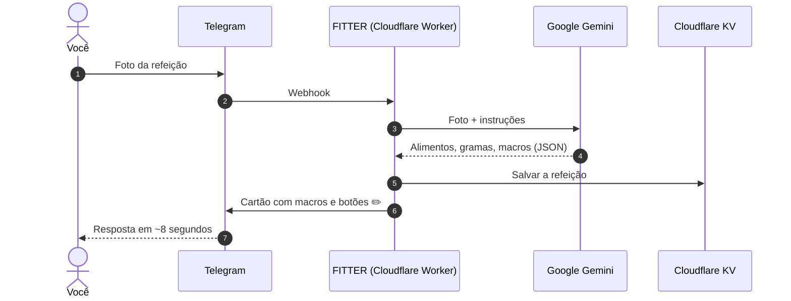

[Русский](README.md) · [English](README.en.md) · [Español](README.es.md) · **Português** · [Deutsch](README.de.md) · [Français](README.fr.md) · [Italiano](README.it.md) · [Türkçe](README.tr.md) · [Українська](README.uk.md) · [Polski](README.pl.md)

 

&nbsp;&nbsp;&nbsp;&nbsp;

<a href="#-recursos">Recursos</a> · <a href="#-como-funciona">Como funciona</a> · <a href="#-capturas-de-tela">Capturas</a> · <a href="https://t.me/arkhitkovv">Contato</a>

> [!IMPORTANT]
> **O FITTER estima as calorias de forma aproximada.** O resultado de uma foto depende dos ingredientes e do tamanho da porção, e qualquer registro pode ser corrigido à mão. O bot não substitui a orientação de um médico ou nutricionista.

> [!NOTE]
> Por enquanto o bot fala russo. Esta página é uma tradução do [README em russo](README.md).

---

## 📸 Capturas de tela

  

---

## ✨ Recursos

---

## 🤖 Comandos

| Comando | O que faz |
|:---|:---|
| `/start` | Apresentação e questionário |
| `/today` · `/week` | Resumo de hoje e dos últimos 7 dias |
| `/water` · `/remind` | Água de hoje e lembretes |
| `/advice` | O que comer: 3 sugestões da IA |
| `/pills` | Remédios: marcar, adicionar, apagar |
| `/weight 72.5` | Registrar o peso |
| `/profile` | Perfil e meta diária |
| `/awards` · `/analysis` | Conquistas e análise semanal com IA |
| `/app` | Abrir o diário |
| `/reset` · `/help` | Refazer o questionário e ajuda |
| `/delete` | Apagar todos os seus dados |

---

## 🧠 Como funciona

| Camada | Tecnologia | Por quê |
|:---|:---|:---|
| Interface | Telegram Bot API + Mini App | Todo mundo já tem Telegram, nada para baixar |
| Servidor | Cloudflare Workers | Grátis, 24/7, sem servidores para manter |
| IA | Google Gemini (Flash / Flash-Lite) | Entende fotos e responde em JSON estrito |
| Banco de dados | Cloudflare KV | Grátis e integrado ao Workers |
| Deploy | GitHub → Cloudflare Builds | Cada commit vai sozinho para o servidor |

O servidor inteiro é um único arquivo, [`worker.js`](worker.js), sem dependências.

---

## 🔒 Segurança e privacidade

- O webhook só aceita pedidos com o cabeçalho secreto do Telegram.
- O diário verifica a assinatura criptográfica do Telegram: ninguém abre os dados de outra pessoa.
- As chaves ficam nos secrets da Cloudflare, não no código.
- As fotos **não são guardadas**: vão para o Gemini apenas para o reconhecimento.

Mais detalhes: [política de privacidade](https://sailxx.github.io/FITTER-AI/privacy.html) (em russo).

---

## 🗺 Roteiro

- ✅ **v1** Bot na Cloudflare, questionário, meta, registro por foto, diário, peso, água, rótulos e códigos de barras
- ✅ **v2** Assistente “O que comer”, remédios com lembretes, estatísticas, tema claro e escuro
- ✅ **v2.6** Novo visual do diário, dicas de macros, gráfico da semana; água e remédios renovados no bot
- ✅ **v3.0** Produto: app próprio

Histórico completo: [CHANGELOG.md](CHANGELOG.md) (em russo).

---

## ❓ Dúvidas e ideias

Achou um bug ou tem uma ideia? Abra uma [issue](https://github.com/sailxx/FITTER-AI/issues/new) ou escreva para o autor no Telegram: [@arkhitkovv](https://t.me/arkhitkovv).

---

## ⚖️ Licença

O FITTER é distribuído sob a licença **MIT**, veja [LICENSE](LICENSE). É um projeto independente e não tem relação com Telegram, Google ou Cloudflare. Os nomes pertencem aos seus donos.

   
  
   
  <b>FITTER</b> · Uma foto. Controle total.
   
  Feito por <a href="https://t.me/arkhitkovv">Vlad</a>. Se o projeto te ajudou, deixe uma ⭐ no repositório.

