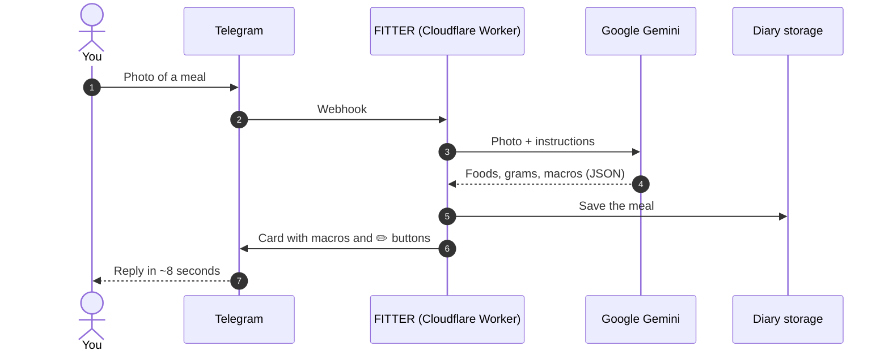

[English](README.md) · [العربية](README.ar.md) · [简体中文](README.zh-CN.md) · [繁體中文](README.zh-TW.md) · [Čeština](README.cs.md) · [Français](README.fr.md) · [Deutsch](README.de.md) · [Ελληνικά](README.el.md) · [Bahasa Indonesia](README.id.md) · [Gaeilge](README.ga.md) · [Italiano](README.it.md) · [日本語](README.ja.md) · [한국어](README.ko.md) · [Polski](README.pl.md) · **Română** · [Русский](README.ru.md) · [Español](README.es.md) · [Українська](README.uk.md) · [اردو](README.ur.md) · [ئۇيغۇرچە](README.ug.md) · [Tiếng Việt](README.vi.md) · [Português](README.pt.md) · [Türkçe](README.tr.md)

 

&nbsp; &nbsp;&nbsp; &nbsp;

<a href="#-features">Caracteristici</a> · <a href="#-how-it-works">Cum funcționează</a> · <a href="#-screenshots">Capturi de ecran</a> · <a href="https://t.me/arkhitkovv">Contact</a>

> [!IMPORTANT]
> **FITTER estimează caloriile aproximative.** Rezultatele fotografiilor depind de ingrediente și de dimensiunea porției, iar orice intrare poate fi corectată manual. Botul nu înlocuiește sfatul unui medic sau dietetician.

---

## 📸 Capturi de ecran

  

---

## ✨ Caracteristici

---

## 🤖 Comenzi

| Comanda | Ce face |
|:---|:---|
| `/start` | Introducere și sondaj |
| `/today` · `/week` | Rezumatul de astăzi și ultimele 7 zile |
| `/water` · `/remind` | Apa și mementourile de astăzi |
| `/advice` | Ce să mănânci: 3 sugestii AI |
| `/pills` | Pastile: marcați, adăugați, ștergeți |
| `/weight 72.5` | Înregistrați-vă greutatea |
| `/profile` | Profil și țintă zilnică |
| `/awards` · `/analysis` | Realizări și revizuire săptămânală AI |
| `/app` | Deschide jurnalul |
| `/reset` · `/help` | Reluați sondajul și ajutați |
| `/devices` | Vizualizați și deconectați dispozitivele Android conectate |
| `/delete` | Ștergeți toate datele dvs |

---

## 🧠 Cum funcționează

| Strat | Tehnologie | De ce |
|:---|:---|:---|
| Interfață | Telegram Bot API + Mini App | Toată lumea are deja Telegram, nimic de descărcat |
| Server | Lucrătorii Cloudflare | Gratuit, 24/7, fără servere de administrat |
| AI | Google Gemini (Flash / Flash-Lite) | Înțelege fotografiile, răspunde în JSON strict |
| Baza de date | Cloudflare Durable Objects și KV | Jurnalul consecvent scrie și date în cache |
| Implementează | GitHub → Compilări Cloudflare | Fiecare commit este trimis la server de la sine |

Întregul server este un singur fișier, [`worker.js`](worker.js), cu zero dependențe.

---

## 🔒 Securitate și confidențialitate

- Webhook-ul acceptă numai cereri cu antetul secret al lui Telegram.
- Jurnalul verifică semnătura criptografică a lui Telegram, astfel încât nimeni să nu poată deschide datele altcuiva.
- Cheile se află în secretele Cloudflare, nu în cod.
- Fotografiile sunt **nu sunt stocate**: merg la Gemeni doar pentru recunoaștere.

Mai mult: [Politica de confidențialitate](https://sailxx.github.io/FITTER-AI/privacy.html).

---

## 🗺 Foaia de parcurs

- [x] **v1** Cloudflare bot, sondaj, țintă, înregistrare foto, jurnal, greutate, apă, etichete și coduri de bare
- [x] **v2** “Ce să mănânci” asistent, pastile cu mementouri, analitice, temă luminoasă și întunecată
- [x] **v2.6** Aspect nou de jurnal, sugestii macro, diagramă a săptămânii; apă și pastile reproiectate în bot
- [x] **v3.0** Produs: o aplicație autonomă Android cu widget-uri
- [x] **v3.8** Engleză și rusă peste tot: bot, jurnal, aplicație Android, widget-uri și site web, cu comutare de limbă
- [x] **v3.12** Coduri de conectare unice Android, revocare a dispozitivului și sincronizare mai rapidă a jurnalului

Istoria completă: [CHANGELOG.md](CHANGELOG.md) ([în rusă](CHANGELOG.ru.md)).

---

## ❓ Întrebări și idei

Ați găsit o eroare sau aveți o idee de caracteristică? Deschide o [emisiune](https://github.com/sailxx/FITTER-AI/issues/new) sau trimiteți un mesaj autorului pe Telegram: [@arkhitkovv](https://t.me/arkhitkovv).

---

## ⚖️ Licenţă

FITTER este lansat sub **Apache 2.0** licență, vezi [LICENSE](LICENSE). Este un proiect independent și nu este afiliat cu Telegram, Google sau Cloudflare. Toate numele aparțin proprietarilor lor.

   
  
   
  <b>FITTER</b> · O fotografie. Control total.
   

