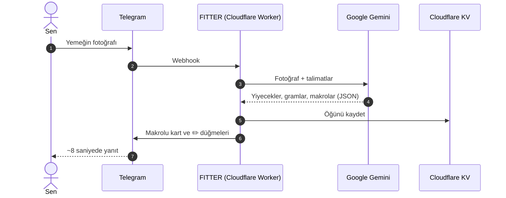

[Русский](README.ru.md) · [English](README.md) · [Español](README.es.md) · [Português](README.pt.md) · [Deutsch](README.de.md) · [Français](README.fr.md) · [Italiano](README.it.md) · **Türkçe** · [Українська](README.uk.md) · [Polski](README.pl.md)

 

&nbsp;&nbsp;&nbsp;&nbsp;

<a href="#-özellikler">Özellikler</a> · <a href="#-nasıl-çalışır">Nasıl çalışır</a> · <a href="#-ekran-görüntüleri">Ekran görüntüleri</a> · <a href="https://t.me/arkhitkovv">İletişim</a>

> [!IMPORTANT]
> **FITTER kalorileri yaklaşık olarak hesaplar.** Fotoğraftan çıkan sonuç malzemelere ve porsiyon büyüklüğüne bağlıdır; her kayıt elle düzeltilebilir. Bot, bir doktorun veya diyetisyenin tavsiyesinin yerini tutmaz.

> [!NOTE]
> Bot şimdilik Rusça konuşuyor. Bu sayfa [Rusça README](README.md) dosyasının çevirisidir.

---

## 📸 Ekran görüntüleri

  

---

## ✨ Özellikler

---

## 🤖 Komutlar

| Komut | Ne yapar |
|:---|:---|
| `/start` | Tanışma ve anket |
| `/today` · `/week` | Bugünün ve son 7 günün özeti |
| `/water` · `/remind` | Bugünkü su ve hatırlatmalar |
| `/advice` | Ne yesem: YZ'den 3 öneri |
| `/pills` | İlaçlar: işaretle, ekle, sil |
| `/weight 72.5` | Kiloyu kaydet |
| `/profile` | Profil ve günlük hedef |
| `/awards` · `/analysis` | Başarılar ve YZ'nin haftalık değerlendirmesi |
| `/app` | Günlüğü aç |
| `/reset` · `/help` | Anketi yeniden doldur ve yardım |
| `/delete` | Tüm verilerini sil |

---

## 🧠 Nasıl çalışır

| Katman | Teknoloji | Neden |
|:---|:---|:---|
| Arayüz | Telegram Bot API + Mini App | Herkeste Telegram zaten var, indirilecek bir şey yok |
| Sunucu | Cloudflare Workers | Ücretsiz, 7/24, yönetilecek sunucu yok |
| YZ | Google Gemini (Flash / Flash-Lite) | Fotoğrafları anlar, katı JSON ile yanıt verir |
| Veritabanı | Cloudflare KV | Ücretsiz ve Workers'a yerleşik |
| Dağıtım | GitHub → Cloudflare Builds | Her commit sunucuya kendiliğinden gider |

Sunucunun tamamı tek bir dosya: [`worker.js`](worker.js), sıfır bağımlılık.

---

## 🔒 Güvenlik ve gizlilik

- Webhook yalnızca Telegram'ın gizli başlığını taşıyan istekleri kabul eder.
- Günlük, Telegram'ın kriptografik imzasını doğrular; kimse başkasının verilerini açamaz.
- Anahtarlar kodda değil, Cloudflare secret'larında durur.
- Fotoğraflar **saklanmaz**: yalnızca tanıma için Gemini'ye gider.

Ayrıntılar: [gizlilik politikası](https://sailxx.github.io/FITTER-AI/privacy.html) (Rusça).

---

## 🗺 Yol haritası

- [x] **v1** Cloudflare'de bot, anket, hedef, fotoğrafla kayıt, günlük, kilo, su, etiketler ve barkodlar
- [x] **v2** “Ne yesem” asistanı, hatırlatmalı ilaçlar, istatistikler, açık ve koyu tema
- [x] **v2.6** Günlüğün yeni görünümü, makro ipuçları, haftalık grafik; botta yenilenen su ve ilaçlar
- [ ] **v3.0** Ürün: bağımsız uygulama

Tüm geçmiş: [CHANGELOG.md](CHANGELOG.md) (Rusça).

---

## ❓ Sorular ve fikirler

Bir hata mı buldun ya da bir fikrin mi var? Bir [issue](https://github.com/sailxx/FITTER-AI/issues/new) aç veya yazara Telegram'dan yaz: [@arkhitkovv](https://t.me/arkhitkovv).

---

## ⚖️ Lisans

FITTER **MIT** lisansıyla yayınlanır, bkz. [LICENSE](LICENSE). Bağımsız bir projedir; Telegram, Google veya Cloudflare ile bağlantısı yoktur. Tüm adlar sahiplerine aittir.

   
  
   
  <b>FITTER</b> · Tek fotoğraf. Tam kontrol.
   
  <a href="https://t.me/arkhitkovv">Vlad</a> tarafından yapıldı. Proje işine yaradıysa depoya bir ⭐ ver.

