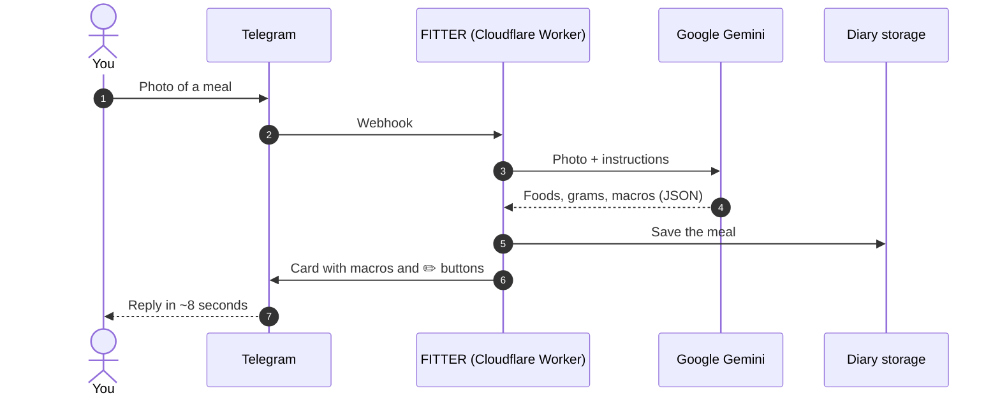

[English](README.md) · [العربية](README.ar.md) · [简体中文](README.zh-CN.md) · [繁體中文](README.zh-TW.md) · [Čeština](README.cs.md) · [Français](README.fr.md) · [Deutsch](README.de.md) · [Ελληνικά](README.el.md) · [Bahasa Indonesia](README.id.md) · [Gaeilge](README.ga.md) · [Italiano](README.it.md) · [日本語](README.ja.md) · [한국어](README.ko.md) · [Polski](README.pl.md) · [Română](README.ro.md) · [Русский](README.ru.md) · [Español](README.es.md) · [Українська](README.uk.md) · [اردو](README.ur.md) · **ئۇيغۇرچە** · [Tiếng Việt](README.vi.md) · [Português](README.pt.md) · [Türkçe](README.tr.md)

 

&nbsp; & nbsp;&nbsp; & nbsp;

<a href="#-features">Features</a> · <a href="#-how-it-works">قانداق ئىشلەيدۇ</a> · <a href="#-screenshots">ئېكران كۆرۈنۈشلىرى</a> · <a href="https://t.me/arkhitkovv">ئالاقىلىشىڭ</a>

> [!IMPORTANT]
> **FITTER تەخمىنەن ئىسسىقلىق ئېنېرگىيىسىنى مۆلچەرلەيدۇ.** رەسىم نەتىجىسى تەركىب ۋە بۆلەكنىڭ چوڭ-كىچىكلىكىگە باغلىق ، ھەر قانداق كىرىشنى قول بىلەن تۈزەتكىلى بولىدۇ. بوت دوختۇر ياكى يېمەك-ئىچمەك دوختۇرىنىڭ نەسىھىتىنىڭ ئورنىنى ئالمايدۇ.

---

## 📸 ئېكران كۆرۈنۈشلىرى

  

---

## ✨ Features

---

## 🤖 بۇيرۇقلار

| بۇيرۇق | ئۇ نېمە قىلىدۇ |
|:---|:---|
| `/start` | تونۇشتۇرۇش ۋە تەكشۈرۈش |
| `/today` · `/week` | بۈگۈنكى خۇلاسە ۋە ئاخىرقى 7 كۈن |
| `/water` · `/remind` | بۈگۈنكى سۇ ۋە ئەسكەرتىش |
| `/advice` | نېمە يېيىش: 3 AI تەكلىپ |
| `/pills` | دورىلار: بەلگە ، قوشۇش ، ئۆچۈرۈش |
| `/weight 72.5` | ئېغىرلىقىڭىزنى خاتىرىلەڭ |
| `/profile` | ئارخىپ ۋە كۈندىلىك نىشان |
| `/awards` · `/analysis` | مۇۋەپپەقىيەتلەر ۋە AI ھەپتىلىك باھالاش |
| `/app` | كۈندىلىك خاتىرىسىنى ئېچىڭ |
| `/reset` · `/help` | تەكشۈرۈش ۋە ياردەمنى قايتۇرۇڭ |
| `/devices` | تىزىملاتقان Android ئۈسكۈنىلىرىنى كۆرۈش ۋە ئۈزۈش |
| `/delete` | بارلىق سانلىق مەلۇماتلىرىڭىزنى ئۆچۈرۈڭ |

---

## 🧠 قانداق ئىشلەيدۇ

| Layer | تېخنىكا | نېمىشقا |
|:---|:---|:---|
| كۆرۈنمە يۈزى | Telegram Bot API + Mini App | ھەممەيلەندە Telegram بار ، چۈشۈرگىلى بولمايدۇ |
| مۇلازىمېتىر | Cloudflare Workers | ھەقسىز ، 24/7 ، باشقۇرغۇدەك مۇلازىمېتىر يوق |
| AI | Google Gemini (Flash / Flash-Lite) | رەسىملەرنى چۈشىنىدۇ ، قاتتىق JSON دا جاۋاب بېرىدۇ |
| ساندان | Cloudflare چىداملىق جىسىملار ۋە KV | ئىزچىل كۈندىلىك خاتىرىلەر سانلىق مەلۇماتلارنى يازىدۇ ۋە ساقلايدۇ |
| ئورۇنلاشتۇرۇش | GitHub → Cloudflare قۇردى | ھەر بىر ۋەدىسىنى ئۆزى مۇلازىمېتىرغا ئەۋەتىدۇ |

پۈتكۈل مۇلازىمېتىر بىرلا ھۆججەت, [`worker.js`](worker.js), تايىنىشچانلىقى نۆل.

---

## 🔒 بىخەتەرلىك ۋە مەخپىيەتلىك

- Webhook پەقەت Telegram نىڭ مەخپىي ماۋزۇسى بىلەن تەلەپلەرنى قوبۇل قىلىدۇ.
- كۈندىلىك خاتىرە Telegram نىڭ شىفىرلىق ئىمزاسىنى تەكشۈرىدۇ ، شۇڭا ھېچكىم باشقىلارنىڭ سانلىق مەلۇماتلىرىنى ئاچالمايدۇ.
- ئاچقۇچ كودتا ئەمەس ، Cloudflare مەخپىيىتىدە ياشايدۇ.
- سۈرەتلەر **ساقلانمىدى**: ئۇلار پەقەت Gemini غا بارىدۇ.

تېخىمۇ كۆپ: [مەخپىيەتلىك تۈزۈمى](https://sailxx.github.io/FITTER-AI/privacy.html).

---

## 🗺 يول خەرىتىسى

- [x] **v1** Cloudflare بوت ، تەكشۈرۈش ، نىشان ، رەسىم خاتىرىلەش ، كۈندىلىك خاتىرە ، ئېغىرلىق ، سۇ ، بەلگە ۋە تاياقچە كودى
- [x] **v2** “نېمە يېيىش »ياردەمچىسى ، ئەسكەرتىش ، ئانالىز ، يورۇقلۇق ۋە قاراڭغۇ تېما
- [x] **v2.6** يېڭى كۈندىلىك كۆرۈنۈش ، ماكرو بېشارەتلەر ، ھەپتە جەدۋىلى قايتا ياسالغان سۇ ۋە دورىلار
- [x] **v3.0** مەھسۇلات: كىچىك قوراللار بىلەن مۇستەقىل Android دېتالى
- [x] **v3.8** ھەممە يەردە ئىنگلىزچە ۋە رۇسچە: bot ، كۈندىلىك خاتىرە ، Android دېتالى ، كىچىك قوراللار ۋە تور بېكەت ، تىل ئالماشتۇرغۇچ
- [x] **v3.12** بىر قېتىم Android كىرىش كودى ، ئۈسكۈنىلەرنى ئەمەلدىن قالدۇرۇش ۋە كۈندىلىك كۈندىلىك ماسقەدەملەش

تولۇق تارىخ: [CHANGELOG.md](CHANGELOG.md) ([رۇس تىلىدا](CHANGELOG.ru.md)).

---

## ❓ سوئال ۋە پىكىر

كەمتۈك تېپىلدىمۇ ياكى ئىقتىدار ئىدىيىسى بارمۇ؟ ئېچىڭ [مەسىلە](https://github.com/sailxx/FITTER-AI/issues/new) ياكى ئاپتورغا Telegram غا ئۇچۇر يوللاڭ: [@arkhitkovv](https://t.me/arkhitkovv).

---

## ⚖️ ئىجازەتنامە

FITTER نىڭ ئاستىدا تارقىتىلدى **Apache 2.0** ئىجازەتنامە ، قاراڭ [LICENSE](LICENSE). ئۇ مۇستەقىل تۈر بولۇپ ، Telegram ، Google ياكى Cloudflare بىلەن مۇناسىۋىتى يوق. بارلىق ئىسىملار ئۇلارنىڭ ئىگىسىگە تەۋە.

   
  
   
  <b>FITTER</b> · بىر پارچە رەسىم. تولۇق كونترول.
   

