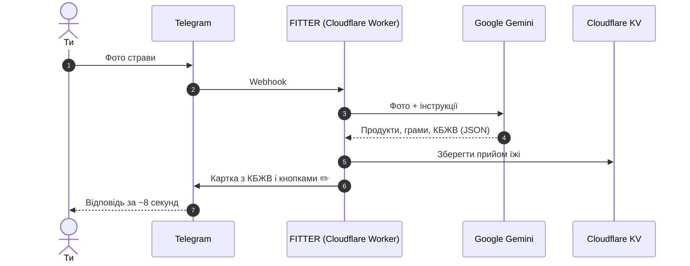

[Русский](README.ru.md) · [English](README.md) · [Español](README.es.md) · [Português](README.pt.md) · [Deutsch](README.de.md) · [Français](README.fr.md) · [Italiano](README.it.md) · [Türkçe](README.tr.md) · **Українська** · [Polski](README.pl.md)

 

&nbsp;&nbsp;&nbsp;&nbsp;

<a href="#-можливості">Можливості</a> · <a href="#-як-це-працює">Як працює</a> · <a href="#-скриншоти">Скриншоти</a> · <a href="https://t.me/arkhitkovv">Зв’язок</a>

> [!IMPORTANT]
> **FITTER оцінює калорії приблизно.** Результат за фото залежить від складу й розміру порції, а будь-який запис можна виправити вручну. Бот не замінює консультацію лікаря чи дієтолога.

> [!NOTE]
> Поки що бот розмовляє російською. Ця сторінка — переклад [російського README](README.md).

---

## 📸 Скриншоти

  

---

## ✨ Можливості

---

## 🤖 Команди

| Команда | Що робить |
|:---|:---|
| `/start` | Знайомство й анкета |
| `/today` · `/week` | Підсумок за сьогодні й за останні 7 днів |
| `/water` · `/remind` | Вода за сьогодні й нагадування |
| `/advice` | Що з’їсти: 3 пропозиції від ШІ |
| `/pills` | Таблетки: відмітити, додати, видалити |
| `/weight 72.5` | Записати вагу |
| `/profile` | Профіль і денна норма |
| `/awards` · `/analysis` | Досягнення й тижневий розбір від ШІ |
| `/app` | Відкрити щоденник |
| `/reset` · `/help` | Пройти анкету заново й довідка |
| `/delete` | Видалити всі свої дані |

---

## 🧠 Як це працює

| Шар | Технологія | Навіщо |
|:---|:---|:---|
| Інтерфейс | Telegram Bot API + Mini App | Telegram уже є в усіх, нічого не треба завантажувати |
| Сервер | Cloudflare Workers | Безкоштовно, 24/7, без власних серверів |
| ШІ | Google Gemini (Flash / Flash-Lite) | Розуміє фото, відповідає строгим JSON |
| База даних | Cloudflare KV | Безкоштовна й вбудована в Workers |
| Деплой | GitHub → Cloudflare Builds | Кожен коміт сам потрапляє на сервер |

Увесь сервер — один файл [`worker.js`](worker.js) без залежностей.

---

## 🔒 Безпека та приватність

- Webhook приймає лише запити із секретним заголовком Telegram.
- Щоденник перевіряє криптографічний підпис Telegram, тож ніхто не відкриє чужі дані.
- Ключі зберігаються в секретах Cloudflare, а не в коді.
- Фото **не зберігаються**: вони потрапляють у Gemini лише для розпізнавання.

Докладніше: [політика конфіденційності](https://sailxx.github.io/FITTER-AI/privacy.html) (російською).

---

## 🗺 Дорожня карта

- [x] **v1** Бот на Cloudflare, анкета, норма, облік за фото, щоденник, вага, вода, етикетки й штрихкоди
- [x] **v2** Помічник «Що з’їсти», таблетки з нагадуваннями, аналітика, світла й темна тема
- [x] **v2.6** Новий вигляд щоденника, підказки до БЖВ, графік тижня; оновлені вода й таблетки в боті
- [ ] **v3.0** Продукт: окремий застосунок

Уся історія: [CHANGELOG.md](CHANGELOG.md) (російською).

---

## ❓ Питання та ідеї

Знайшли помилку або маєте ідею? Відкрийте [issue](https://github.com/sailxx/FITTER-AI/issues/new) або напишіть авторові в Telegram: [@arkhitkovv](https://t.me/arkhitkovv).

---

## ⚖️ Ліцензія

FITTER поширюється за ліцензією **Apache 2.0**, див. [LICENSE](LICENSE). Це незалежний проєкт, не пов’язаний із Telegram, Google чи Cloudflare. Усі назви належать їхнім власникам.

   
  
   
  <b>FITTER</b> · Одне фото. Повний контроль.
   
  Зробив <a href="https://t.me/arkhitkovv">Владислав</a>. Якщо проєкт вам допоміг, поставте репозиторію ⭐

