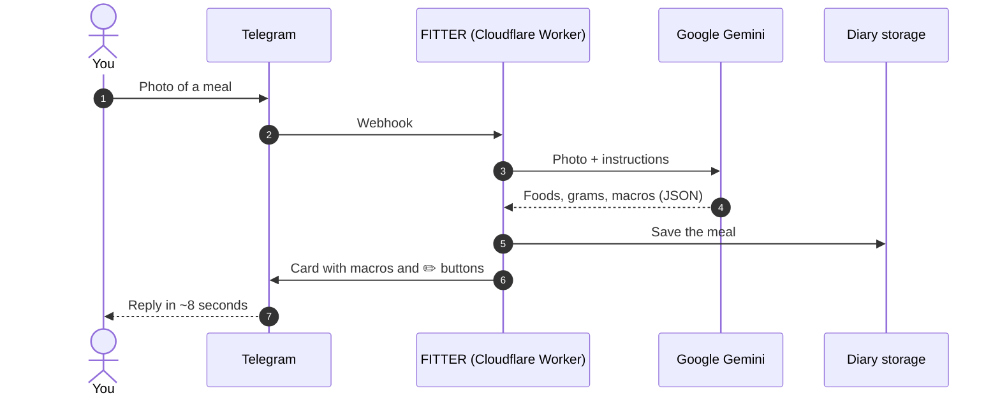

[English](README.md) · [العربية](README.ar.md) · [简体中文](README.zh-CN.md) · [繁體中文](README.zh-TW.md) · [Čeština](README.cs.md) · [Français](README.fr.md) · [Deutsch](README.de.md) · [Ελληνικά](README.el.md) · [Bahasa Indonesia](README.id.md) · [Gaeilge](README.ga.md) · [Italiano](README.it.md) · [日本語](README.ja.md) · [한국어](README.ko.md) · [Polski](README.pl.md) · [Română](README.ro.md) · [Русский](README.ru.md) · [Español](README.es.md) · [Українська](README.uk.md) · **اردو** · [ئۇيغۇرچە](README.ug.md) · [Tiếng Việt](README.vi.md) · [Português](README.pt.md) · [Türkçe](README.tr.md)

 

&nbsp; &nbsp;&nbsp; &nbsp;

<a href="#-features">خصوصیات</a> · <a href="#-how-it-works">یہ کیسے کام کرتا ہے۔</a> · <a href="#-screenshots">اسکرین شاٹس</a> · <a href="https://t.me/arkhitkovv">رابطہ کریں۔</a>

> [!IMPORTANT]
> **FITTER تقریباً کیلوریز کا تخمینہ لگاتا ہے۔** تصویر کے نتائج اجزاء اور حصے کے سائز پر منحصر ہیں، اور کسی بھی اندراج کو ہاتھ سے درست کیا جا سکتا ہے۔ بوٹ ڈاکٹر یا غذائی ماہرین کے مشورے کی جگہ نہیں لیتا ہے۔

---

## 📸 اسکرین شاٹس

  

---

## ✨ خصوصیات

---

## 🤖 احکام

| حکم | یہ کیا کرتا ہے |
|:---|:---|
| `/start` | تعارف اور سروے |
| `/today` · `/week` | آج کا خلاصہ اور پچھلے 7 دن |
| `/water` · `/remind` | آج کا پانی اور یاددہانی |
| `/advice` | کیا کھائیں: 3 AI تجاویز |
| `/pills` | گولیاں: نشان زد کریں، شامل کریں، حذف کریں۔ |
| `/weight 72.5` | اپنا وزن درج کریں۔ |
| `/profile` | پروفائل اور روزانہ کا ہدف |
| `/awards` · `/analysis` | کامیابیاں اور AI ہفتہ وار جائزہ |
| `/app` | ڈائری کھولو |
| `/reset` · `/help` | سروے دوبارہ کریں اور مدد کریں۔ |
| `/devices` | سائن ان Android آلات دیکھیں اور منقطع کریں۔ |
| `/delete` | اپنا تمام ڈیٹا حذف کریں۔ |

---

## 🧠 یہ کیسے کام کرتا ہے۔

| تہہ | ٹیکنالوجی | کیوں |
|:---|:---|:---|
| انٹرفیس | Telegram Bot API + Mini ایپ | ہر ایک کے پاس پہلے سے ہی Telegram ہے، ڈاؤن لوڈ کرنے کے لیے کچھ بھی نہیں۔ |
| سرور | کلاؤڈ فلیئر ورکرز | مفت، 24/7، انتظام کرنے کے لیے کوئی سرور نہیں۔ |
| AI | Google Gemini (Flash / Flash-Lite) | تصاویر کو سمجھتا ہے، سخت JSON میں جواب دیتا ہے۔ |
| ڈیٹا بیس | Cloudflare پائیدار آبجیکٹ اور KV | مستقل ڈائری لکھتا ہے اور محفوظ شدہ ڈیٹا |
| تعینات کریں۔ | GitHub → Cloudflare Builds | ہر کمٹ خود ہی سرور پر بھیجتا ہے۔ |

پورا سرور ایک فائل ہے۔, [`worker.js`](worker.js), صفر انحصار کے ساتھ۔

---

## 🔒 سیکیورٹی اور رازداری

- ویب ہک صرف Telegram کے خفیہ ہیڈر کے ساتھ درخواستیں قبول کرتا ہے۔
- ڈائری Telegram کے کرپٹوگرافک دستخط کو چیک کرتی ہے، اس لیے کوئی بھی کسی اور کا ڈیٹا نہیں کھول سکتا۔
- چابیاں Cloudflare رازوں میں رہتی ہیں، کوڈ میں نہیں۔
- فوٹوز ہیں۔ **ذخیرہ نہیں**: وہ صرف شناخت کے لیے جیمنی کے پاس جاتے ہیں۔

مزید: [رازداری کی پالیسی](https://sailxx.github.io/FITTER-AI/privacy.html).

---

## 🗺 روڈ میپ

- [x] **v1** Cloudflare بوٹ، سروے، ہدف، فوٹو لاگنگ، ڈائری، وزن، پانی، لیبلز اور بارکوڈز
- [x] **v2** “کیا کھائیں" اسسٹنٹ، یاد دہانیوں کے ساتھ گولیاں، تجزیات، روشنی اور سیاہ تھیم
- [x] **v2.6** نئی ڈائری کی شکل، میکرو اشارے، ہفتہ چارٹ؛ بوٹ میں پانی اور گولیوں کو دوبارہ ڈیزائن کیا گیا۔
- [x] **v3.0** پروڈکٹ: ویجٹس کے ساتھ ایک اسٹینڈ اسٹون Android ایپ
- [x] **v3.8** انگریزی اور روسی ہر جگہ: بوٹ، ڈائری، Android ایپ، ویجٹ اور ویب سائٹ، زبان کے سوئچ کے ساتھ
- [x] **v3.12** ایک بار کے Android سائن ان کوڈز، ڈیوائس کی منسوخی اور تیز تر ڈائری کی مطابقت پذیری

مکمل تاریخ: [CHANGELOG.md](CHANGELOG.md) ([روسی میں](CHANGELOG.ru.md)).

---

## ❓ سوالات اور خیالات

کوئی بگ ملا یا کوئی فیچر آئیڈیا ہے؟ ایک کھولیں۔ [مسئلہ](https://github.com/sailxx/FITTER-AI/issues/new) یا مصنف کو Telegram پر میسج کریں۔: [@arkhitkovv](https://t.me/arkhitkovv).

---

## ⚖️ لائسنس

FITTER کے تحت جاری کیا گیا ہے۔ **Apache 2.0** لائسنس، دیکھیں [LICENSE](LICENSE). یہ ایک آزاد پروجیکٹ ہے اور Telegram، Google یا Cloudflare سے وابستہ نہیں ہے۔ تمام نام ان کے مالکان کے ہیں۔

   
  
   
  <b>FITTER</b> · ایک تصویر۔ مکمل کنٹرول۔
   

