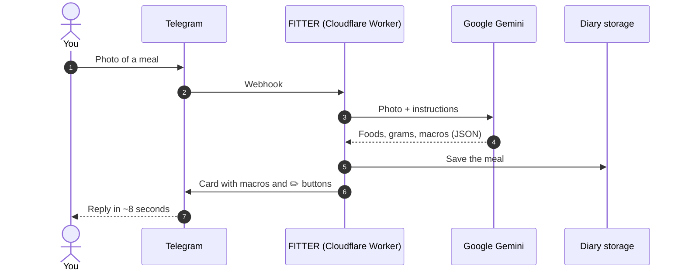

[English](README.md) · [العربية](README.ar.md) · [简体中文](README.zh-CN.md) · [繁體中文](README.zh-TW.md) · [Čeština](README.cs.md) · [Français](README.fr.md) · [Deutsch](README.de.md) · [Ελληνικά](README.el.md) · [Bahasa Indonesia](README.id.md) · [Gaeilge](README.ga.md) · [Italiano](README.it.md) · [日本語](README.ja.md) · [한국어](README.ko.md) · [Polski](README.pl.md) · [Română](README.ro.md) · [Русский](README.ru.md) · [Español](README.es.md) · [Українська](README.uk.md) · [اردو](README.ur.md) · [ئۇيغۇرچە](README.ug.md) · **Tiếng Việt** · [Português](README.pt.md) · [Türkçe](README.tr.md)

 

&nbsp; &nbsp;&nbsp; &nbsp;

<a href="#-features">Đặc trưng</a> · <a href="#-how-it-works">Nó hoạt động như thế nào</a> · <a href="#-screenshots">Ảnh chụp màn hình</a> · <a href="https://t.me/arkhitkovv">Liên hệ</a>

> [!IMPORTANT]
> **FITTER ước tính lượng calo xấp xỉ.** Kết quả ảnh phụ thuộc vào thành phần và kích thước phần, đồng thời mọi mục nhập đều có thể được sửa bằng tay. Bot không thay thế lời khuyên của bác sĩ hoặc chuyên gia dinh dưỡng.

---

## 📸 Ảnh chụp màn hình

  

---

## ✨ Đặc trưng

---

## 🤖 Lệnh

| Yêu cầu | Nó làm gì |
|:---|:---|
| `/start` | Giới thiệu và khảo sát |
| `/today` · `/week` | Tóm tắt hôm nay và 7 ngày qua |
| `/water` · `/remind` | Nước uống hôm nay và lời nhắc nhở |
| `/advice` | Ăn gì: 3 gợi ý AI |
| `/pills` | Thuốc: đánh dấu, thêm, xóa |
| `/weight 72.5` | Ghi lại cân nặng của bạn |
| `/profile` | Hồ sơ và mục tiêu hàng ngày |
| `/awards` · `/analysis` | Thành tích và đánh giá AI hàng tuần |
| `/app` | Mở nhật ký |
| `/reset` · `/help` | Thực hiện lại cuộc khảo sát và trợ giúp |
| `/devices` | Xem và ngắt kết nối các thiết bị Android đã đăng nhập |
| `/delete` | Xóa tất cả dữ liệu của bạn |

---

## 🧠 Nó hoạt động như thế nào

| Lớp | Công nghệ | Tại sao |
|:---|:---|:---|
| Giao diện | Telegram Bot API + Ứng dụng nhỏ | Mọi người đã có Telegram rồi, chẳng có gì để tải cả |
| Máy chủ | Công nhân đám mây | Miễn phí, 24/7, không cần quản lý máy chủ |
| AI | Google Song Tử (Flash / Flash-Lite) | Hiểu ảnh, trả lời nghiêm ngặt JSON |
| Cơ sở dữ liệu | Đối tượng bền vững của Cloudflare và KV | Ghi nhật ký nhất quán và lưu trữ dữ liệu |
| Triển khai | GitHub → Bản dựng Cloudflare | Mọi cam kết đều tự chuyển đến máy chủ |

Toàn bộ máy chủ là một tập tin duy nhất, [`worker.js`](worker.js), với sự phụ thuộc bằng không.

---

## 🔒 Bảo mật và quyền riêng tư

- Webhook chỉ chấp nhận các yêu cầu có tiêu đề bí mật của Telegram.
- Nhật ký kiểm tra chữ ký mật mã của Telegram nên không ai có thể mở dữ liệu của người khác.
- Chìa khóa nằm trong bí mật của Cloudflare chứ không phải trong mã.
- Hình ảnh được **không được lưu trữ**: họ đến gặp Song Tử chỉ để được công nhận.

Hơn: [chính sách bảo mật](https://sailxx.github.io/FITTER-AI/privacy.html).

---

## 🗺 Lộ trình

- [x] **v1** Cloudflare bot, khảo sát, mục tiêu, ghi ảnh, nhật ký, trọng lượng, nước, nhãn và mã vạch
- [x] **v2** “Ăn gì”, trợ lý, thuốc có lời nhắc, phân tích, chủ đề sáng và tối
- [x] **v2.6** Giao diện nhật ký mới, gợi ý macro, biểu đồ tuần; nước và thuốc được thiết kế lại trong bot
- [x] **v3.0** Sản phẩm: một ứng dụng Android độc lập với các widget
- [x] **v3.8** Tiếng Anh và tiếng Nga ở mọi nơi: bot, nhật ký, ứng dụng Android, widget và trang web, có chuyển đổi ngôn ngữ
- [x] **v3.12** Mã đăng nhập Android một lần, thu hồi thiết bị và đồng bộ nhật ký nhanh hơn

Lịch sử đầy đủ: [CHANGELOG.md](CHANGELOG.md) ([bằng tiếng Nga](CHANGELOG.ru.md)).

---

## ❓ Câu hỏi và ý tưởng

Tìm thấy một lỗi hoặc có một ý tưởng về tính năng? Mở một [vấn đề](https://github.com/sailxx/FITTER-AI/issues/new) hoặc nhắn tin cho tác giả trên Telegram: [@arkhitkovv](https://t.me/arkhitkovv).

---

## ⚖️ Giấy phép

FITTER được phát hành theo **Apache 2.0** giấy phép, xem [LICENSE](LICENSE). Đây là một dự án độc lập và không liên kết với Telegram, Google hay Cloudflare. Tất cả các tên thuộc về chủ sở hữu của họ.

   
  
   
  <b>FITTER</b> · Một bức ảnh. Kiểm soát hoàn toàn.
   

