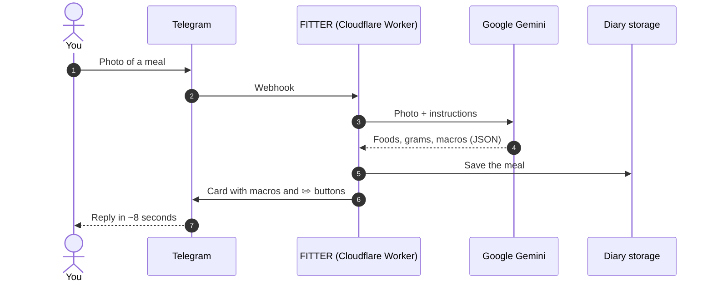

[English](README.md) · [العربية](README.ar.md) · **简体中文** · [繁體中文](README.zh-TW.md) · [Čeština](README.cs.md) · [Français](README.fr.md) · [Deutsch](README.de.md) · [Ελληνικά](README.el.md) · [Bahasa Indonesia](README.id.md) · [Gaeilge](README.ga.md) · [Italiano](README.it.md) · [日本語](README.ja.md) · [한국어](README.ko.md) · [Polski](README.pl.md) · [Română](README.ro.md) · [Русский](README.ru.md) · [Español](README.es.md) · [Українська](README.uk.md) · [اردو](README.ur.md) · [ئۇيغۇرچە](README.ug.md) · [Tiếng Việt](README.vi.md) · [Português](README.pt.md) · [Türkçe](README.tr.md)

 

&nbsp;;&nbsp;;

<a href="#-features">特征</a> · <a href="#-how-it-works">它是如何运作的</a> · <a href="#-screenshots">截图</a> · <a href="https://t.me/arkhitkovv">接触</a>

> [!IMPORTANT]
> **FITTER 估计大约卡路里。** 照片结果取决于成分和份量，任何输入都可以手动纠正。该机器人不能取代医生或营养师的建议。

---

## 📸 截图

  

---

## ✨ 特征

---

## 🤖 命令

| 命令 | 它的作用 |
|:---|:---|
| `/start` | 介绍与调查 |
| `/today` · `/week` | 今天的总结和过去 7 天 |
| `/water` · `/remind` | 今天的水和提醒 |
| `/advice` | 吃什么：3条AI建议 |
| `/pills` | 药丸：标记、添加、删除 |
| `/weight 72.5` | 记录您的体重 |
| `/profile` | 个人资料和每日目标 |
| `/awards` · `/analysis` | 成果及AI周评 |
| `/app` | 打开日记 |
| `/reset` · `/help` | 重新参加调查并提供帮助 |
| `/devices` | 查看和断开已登录的 Android 设备 |
| `/delete` | 删除您的所有数据 |

---

## 🧠 它是如何运作的

| 层 | 技术 | 为什么 |
|:---|:---|:---|
| 界面 | Telegram 机器人 API + 迷你应用程序 | 每个人都已经有了 Telegram ，无需下载 |
| 服务器 | Cloudflare 工人 | 免费，24/7，无需管理服务器 |
| AI | Google Gemini（Flash/Flash-Lite） | 看懂照片，严格回复JSON |
| 数据库 | Cloudflare 耐用对象和 KV | 一致的日记写入和缓存数据 |
| 部署 | GitHub → Cloudflare 构建 | 每个提交都会自行发送到服务器 |

整个服务器是一个文件, [`worker.js`](worker.js), 零依赖性。

---

## 🔒 安全和隐私

- Webhook 仅接受带有 Telegram 秘密标头的请求。
- 日记会检查 Telegram 的加密签名，因此任何人都无法打开其他人的数据。
- 密钥存在于 Cloudflare 秘密中，而不是代码中。
- 照片是 **未存储**: 他们去双子座只是为了得到认可。

更多的: [隐私政策](https://sailxx.github.io/FITTER-AI/privacy.html).

---

## 🗺 路线图

- [x] **v1** Cloudflare 机器人、调查、目标、照片记录、日记、重量、水、标签和条形码
- [x] **v2** “吃什么”助手，带提醒的药丸，分析，浅色和深色主题
- [x] **v2.6** 新日记、宏观提示、周图；重新设计了机器人中的水和药丸
- [x] **v3.0** 产品：带有小部件的独立 Android 应用程序
- [x] **v3.8** 英语和俄语无处不在：机器人、日记、Android 应用程序、小部件和网站，带有语言切换
- [x] **v3.12** 一次性 Android 登录代码、设备撤销和更快的日记同步

完整历史: [CHANGELOG.md](CHANGELOG.md) ([俄语](CHANGELOG.ru.md)).

---

## ❓ 问题和想法

发现错误或有功能想法？打开一个 [问题](https://github.com/sailxx/FITTER-AI/issues/new) 或在Telegram上给作者留言: [@arkhitkovv](https://t.me/arkhitkovv).

---

## ⚖️ 执照

FITTER 是在 **Apache 2.0** 许可证，参见 [LICENSE](LICENSE)。它是一个独立项目，不隶属于 Telegram 、Google 或 Cloudflare。所有名称均属于其所有者。

   
  
   
  <b>FITTER</b> · 一张照片。完全控制。
   

