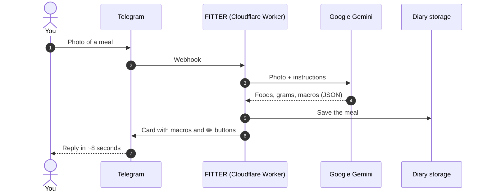

[English](README.md) · [العربية](README.ar.md) · [简体中文](README.zh-CN.md) · **繁體中文** · [Čeština](README.cs.md) · [Français](README.fr.md) · [Deutsch](README.de.md) · [Ελληνικά](README.el.md) · [Bahasa Indonesia](README.id.md) · [Gaeilge](README.ga.md) · [Italiano](README.it.md) · [日本語](README.ja.md) · [한국어](README.ko.md) · [Polski](README.pl.md) · [Română](README.ro.md) · [Русский](README.ru.md) · [Español](README.es.md) · [Українська](README.uk.md) · [اردو](README.ur.md) · [ئۇيغۇرچە](README.ug.md) · [Tiếng Việt](README.vi.md) · [Português](README.pt.md) · [Türkçe](README.tr.md)

 

&nbsp;;&nbsp;;

<a href="#-features">特徵</a> · <a href="#-how-it-works">它是如何運作的</a> · <a href="#-screenshots">截圖</a> · <a href="https://t.me/arkhitkovv">接觸</a>

> [!IMPORTANT]
> **FITTER 估計大約卡路里。** 照片結果取決於成分和份量，任何輸入都可以手動修正。該機器人不能取代醫生或營養師的建議。

---

## 📸 截圖

  

---

## ✨ 特徵

---

## 🤖 命令

| 命令 | 它的作用 |
|:---|:---|
| `/start` | 介紹與調查 |
| `/today` · `/week` | 今天的總結和過去 7 天 |
| `/water` · `/remind` | 今天的水和提醒 |
| `/advice` | 吃什麼：3條AI建議 |
| `/pills` | 藥丸：標記、新增、刪除 |
| `/weight 72.5` | 記錄您的體重 |
| `/profile` | 個人資料和每日目標 |
| `/awards` · `/analysis` | 成果及AI週評 |
| `/app` | 打開日記 |
| `/reset` · `/help` | 重新參加調查並提供協助 |
| `/devices` | 檢視並中斷已登入的 Android 設備 |
| `/delete` | 刪除您的所有數據 |

---

## 🧠 它是如何運作的

| 層 | 科技 | 為什麼 |
|:---|:---|:---|
| 介面 | Telegram 機器人 API + 迷你應用程式 | 每個人都已經有了 Telegram ，無需下載 |
| 伺服器 | Cloudflare 工人 | 免費，24/7，無需管理伺服器 |
| AI | Google Gemini（Flash/Flash-Lite） | 看懂照片，嚴格回覆JSON |
| 資料庫 | Cloudflare 耐用物件與 KV | 一致的日記寫入和快取數據 |
| 部署 | GitHub → Cloudflare 構建 | 每個提交都會自行發送到伺服器 |

整個伺服器是一個文件, [`worker.js`](worker.js), 零依賴性。

---

## 🔒 安全和隱私

- Webhook 僅接受帶有 Telegram 秘密標頭的請求。
- 日記會檢查 Telegram 的加密簽名，因此任何人都無法開啟其他人的資料。
- 金鑰存在於 Cloudflare 秘密中，而不是程式碼中。
- 照片是 **未儲存**: 他們去雙子座只是為了得到認可。

更多的: [隱私權政策](https://sailxx.github.io/FITTER-AI/privacy.html).

---

## 🗺 路線圖

- [x] **v1** Cloudflare 機器人、調查、目標、照片記錄、日記、重量、水、標籤和條碼
- [x] **v2** “吃什麼」助手，帶提醒的藥丸，分析，淺色和深色主題
- [x] **v2.6** 新日記、宏觀提示、週圖；重新設計了機器人中的水和藥丸
- [x] **v3.0** 產品：帶有小部件的獨立 Android 應用程式
- [x] **v3.8** 英語和俄語無處不在：機器人、日記、Android 應用程式、小部件和網站，帶有語言切換
- [x] **v3.12** 一次性 Android 登入代碼、裝置撤銷和更快的日記同步

完整歷史: [CHANGELOG.md](CHANGELOG.md) ([俄文](CHANGELOG.ru.md)).

---

## ❓ 問題和想法

發現錯誤或有功能想法？打開一個 [問題](https://github.com/sailxx/FITTER-AI/issues/new) 或在Telegram上給作者留言: [@arkhitkovv](https://t.me/arkhitkovv).

---

## ⚖️ 執照

FITTER 是在 **Apache 2.0** 許可證，參見 [LICENSE](LICENSE)。它是一個獨立項目，不隸屬於 Telegram 、Google 或 Cloudflare。所有名稱均屬於其所有者。

   
  
   
  <b>FITTER</b> · 一張照片。完全控制。
   

